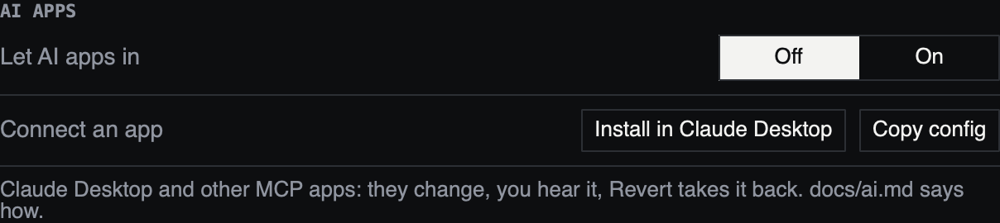

# AI apps

megalooper can be a tool for an AI app on your Mac. Claude Desktop is the
one it was tested with; any app that speaks MCP (the Model Context Protocol)
over stdio should work. You ask in plain words, and the app reads what
megalooper is playing and changes it:

- "Give me a sparse 808 groove that fits this 7/8."
- "Make the hats busier in the second half of the bar."
- "Write a synth line in D dorian that follows the chords you heard."
- "Put a dubby echo on the loop and make the drive gentler."
- "Revert that."

You hear every change at once. **↶ Revert AI change**, at the bottom of the
window, takes the AI's newest change back, and the one before it, up to 32
of them.

It is for preparing, not for the stage: an answer takes a few seconds, and
nothing waits for a bar line.

## What it can do

| | Read | Change |
|---|---|---|
| **The loop** | Its meter (uneven bars too), tempo and length, and what the first take played: the hits on the bar grid, their pitches and the chords heard | — |
| **The drums** | Both step patterns, the kits and their pads | The patterns, the kit the steps play; save as a drum preset |
| **The synth** | The note sequence and the Wave synth's settings | Both, and the sequencer on or off; save as a synth preset |
| **The effects** | Every chain, its devices, switches and settings | Built-in effects in, out, moved, set and switched; save as a sound |

It cannot change the loop, the Cutter, the Grains, the mixer, the drums'
onset kit, Repeats, reverb or trims, or the MIDI map.

Every change needs Megalooper SA (`sa: true`, as `saSystem` has), where
megalooper hosts the drums, the synth and the effects
([Megalooper SA](standalone.md)).

**Plugins stay yours.** The AI may move a plugin in its chain and switch it
on or off. It cannot add one, remove one, or touch the plugin's own
settings, and it does not see them. The same goes for an instrument plugin
playing the synth.

A preset or sound is never saved over one of the same name unless you say
so in the conversation.

## What you need

- **megalooper**, running.
- **An AI app that speaks MCP**, such as Claude Desktop
  (<https://claude.ai/download>). A subscription to the app is all it takes:
  megalooper never sees an API key, and talks to no AI service itself.

For Claude Desktop that is all. Any other app runs megalooper's bridge,
`tools/megalooper-mcp.py`, which needs **Python 3.9 or later** (no packages).
macOS has a `python3` once its command line tools are in
(`xcode-select --install`), or from Homebrew.

## Setting it up

**1. Let AI apps in.** In megalooper's Setup view (5), on its **MIDI & AI**
page, under **AI APPS**, switch **Let AI apps in** to **On**. It stays on
across restarts. While it is off, no app can reach megalooper at all.



*Fig: AI APPS, at the top right of Setup's MIDI & AI page: the switch, and the buttons that connect an app.*

**2. Connect the app.**

- **Claude Desktop:** click **Install in Claude Desktop**, under AI APPS.
  Claude Desktop opens and asks to install the megalooper extension: say
  Install. Once is enough. (The same file, `megalooper.mcpb`, is attached to
  every [release](https://github.com/weltfried/megalooper/releases):
  double-clicking it does the same.)
- **Any other MCP app:** click **Copy config**, and paste what it copies
  into the app's MCP settings. It names this Mac's `python3` and the bridge
  in this folder:

  ```json
  {
    "mcpServers": {
      "megalooper": {
        "command": "/usr/bin/python3",
        "args": ["/Users/you/megalooper/tools/megalooper-mcp.py"]
      }
    }
  }
  ```

  If the app's config already has other settings, add `"mcpServers"` beside
  them. Paths are full paths: an app started from the Dock does not search
  your shell's `PATH`. Claude Desktop takes this too (Settings → Developer →
  Edit Config), if you would rather not use the extension.

**3. Try it.** In a new conversation (restart the app first if you edited
its config), with a loop playing, ask "What is megalooper playing? Describe
the drum pattern lane by lane." Then ask for a change.

## What leaves your Mac

megalooper only answers apps on this Mac. When an app asks, megalooper hands
it the set as text: the meter, the patterns, the settings, the take's hits
on the grid. **No audio, ever.** The app sends that text to its AI service
as part of your conversation, as it would anything you type. If that is
not wanted for a set, switch AI APPS off.

How the connection is kept local: megalooper listens on SuperCollider's
own port, answers only messages from this Mac (127.0.0.1) that carry a
token it makes new at every start, and keeps that token in `remote.json`,
which only your user account can read. The requests and answers pass as
small files in `remote/`, beside it, in megalooper's folder
(`~/Library/Application Support/SuperCollider/megalooper/` on macOS,
`~/.local/share/SuperCollider/megalooper/` on Linux).

## Taking changes back

- **↶ Revert AI change**, at the bottom right of the window, appears once
  the AI has changed something. Each click takes back its newest change;
  "(3)" after it says how many there are.
- **In the conversation**: "revert that", or "revert the last three".
- Revert puts back the part the AI changed as it was just before: the drums
  (both patterns, the kits, the pad trims, Repeats, the reverb), the synth
  (the note sequence, the Wave synth, its switch) or the effects (devices,
  places, settings, switches). A plugin's own sound is never touched, so it
  needs nothing put back.
- What you changed by hand in the same part after the AI's change goes back
  with it: Revert restores the whole drums, synth or effects as they were.
- Reverting a change that added, removed or moved effects empties the
  Effects view's own undo, as recalling a sound does.
- Switching AI APPS off, or restarting megalooper, keeps what the AI did and
  forgets its list of changes. Keep (on each view) is still how a sound,
  drums or synth become what megalooper starts with.

## Good to know

- **The take is what the analysis heard.** The grid of hits comes from
  onset detection on the first take, and the pitches from the pitch
  tracker. A quiet or noisy input makes a sparse or wrong grid. Ask the AI
  to show you what it sees ("show me what I played, bar by bar") before
  asking it to fit something to it. Overdubs are not in it.
- **It knows the settings by their descriptions.** It cannot hear. What it
  knows about an effect is its name, its range and the tooltip you see in
  the window. Expect a good start, and tune by ear.
- **Seven built-in effects.** It works with the effects megalooper has
  (Pitch Shift, Dual Delay, Envelope Filter, Pitch Loops, Tape Echo, Drive,
  Crusher), in any chain.
- **Chain names.** The AI calls the Instrument chain `guitar`; ask for "the
  instrument chain" and it will find it.

## When it does not connect

| The app says | What to do |
|---|---|
| megalooper is not running, or AI apps are not let in | Start megalooper, and switch AI APPS on (Setup › MIDI & AI) |
| megalooper did not answer in 10 s | megalooper is busy or stuck: restart it |
| The megalooper tool is missing, or shows an error | Claude Desktop: Settings → Extensions shows whether megalooper is installed and on; install it again with the button. Another app: check the two paths in its config, then restart it |
| `python3` is not found (other apps) | Put its full path in `command` (`which python3`), or install it (`xcode-select --install`) |

## The tools

What the app is offered, for reference. You never call these yourself.

| Tool | What it does |
|---|---|
| `get_context` | What is playing and how it is set, the take included |
| `describe` | What every setting of the drums, the synth or the effects means |
| `set_drum_pattern` | Change a drum pattern (main or break) and the steps' kit |
| `set_synth` | Change the note sequence, the Wave synth, the sequencer's switch |
| `set_chain` | Add, remove, move, set and switch effects |
| `revert` | Take back the newest change, or several |
| `save_drum_preset`, `save_synth_preset`, `save_sound` | Save under a name, in the menus you already use |

Every change is checked before anything happens: a request with one wrong
part changes nothing. Values outside a setting's range are moved into it,
and the app is told which.
