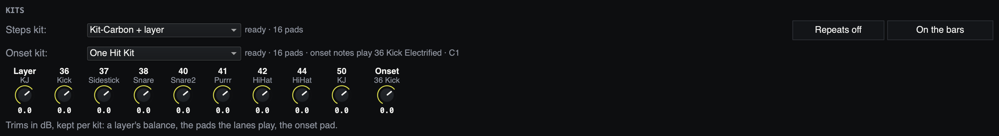
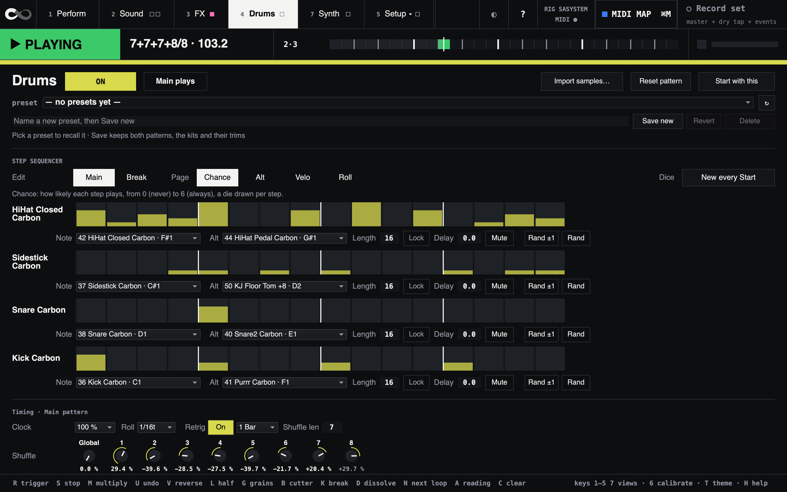

# The drums

Megalooper SA has two drum parts, on the **Drums** view (key **4**):

- **The steps**: two step patterns, a main one and a break, locked to the
  loop's tempo and meter.
- **The onset kit**: a kit played by the loop's own onsets, so the drums
  follow the rhythm you played.

Each part plays a **kit**: a set of samples on pads.

The steps start with every new loop you record. To have them wait instead,
set **New loop** to **Drums off** on the Setup view's Rig page, under Megalooper SA's
levels. A new loop then keeps the drums in time but silent, until you switch
them on: the switch on the Drums view, or a footswitch mapped to it. Overdubs leave
them as they are. megalooper keeps the choice for the next start. Whether
they also stop with the loop is **Drums follow the loop**, on the same page.

## Why the drums are hidden at first

megalooper ships each kit's map and none of its audio. The kits it was built
on play samples that come with Ableton Live, and those cannot be passed on.
Until one kit has its samples on your machine, the Drums view shows a note
and an **Import samples…** button, and nothing else.

There are two ways to get a kit. Both use `tools/export-live-set.py`, which
needs Python 3 and nothing else. The button runs it for you on a folder of
your own samples.

## A kit from Ableton Live

With Live 12 Suite installed, this copies the samples of six drum machines
from Live's Core Library into megalooper's kits folder:

```bash
python3 tools/export-live-set.py kits --only core-808,core-909,core-707,core-c78,core-dry-session,core-flares
```

Without `--only` it also builds the kits of the set megalooper was built
after (`carbon`, `carbon-layer`, `one-hit`), which need Live's packs too.

megalooper starts each part on its usual kit. If that kit has no samples
here, it starts on the first kit that has.

## A kit from your own samples

Put one-shots (wav, aif, flac or ogg) into a folder. Then, on the Drums view:

1. Press **Import samples…**. It is at the top of the Drums view, beside
   **Reset pattern**, or on the note when no kit has its samples yet. It is
   there whenever you want another kit.
2. Choose the folder.
3. A line by the button says how many pads the kit has and which files it
   could not place. The Steps part plays the new kit at once, and
   both kit menus list it. There is no restart.

The kit is named after the folder. Its samples are copied into megalooper's
kits folder, so the folder you chose can be moved or deleted afterwards.
Importing the same folder again replaces its kit. megalooper keeps playing
while the import runs.

The same from a terminal, with a key of your choice (megalooper shows the
kit at its next start):

```bash
python3 tools/export-live-set.py kits --folder ~/Samples/MyKit --key mykit
```

Either way, the files are placed on pads by words in their names:

| Word in the file name | Pads (MIDI notes) |
|---|---|
| kick | 36 |
| rim, side | 37 |
| snare | 38, 40 |
| clap | 39 |
| hat closed, chh | 42 |
| hat pedal | 44 |
| hat open, ohh | 46 |
| tom, from low to high | 41, 43, 45, 47, 48, 50 |
| crash | 49 |
| ride | 51 |
| perc, shaker, cowbell and the like | the pads still free, up to 51 |

The tool prints where each file went. Rename the files it could not place,
and import or run it again.

## Choosing a kit

Each part has a kit menu on the Drums pane. A kit's line says whether it is
ready, and how many pads it plays. **— none —** silences a part.



*Fig: The kits on the Drums view: a menu and a line for each part, and the trims in dB under them.*

## The steps



*Fig: The Drums view (4): the Main pattern on its Chance page, its four lanes, and the timing under them.*

There are two patterns, **Main** and **Break**. The button at the top reads
**Main plays**, and **BREAK plays** while the break pattern plays. The
loop's break switches it; a click switches it by hand until the next break.

**Edit** chooses which pattern the lanes show. That changes nothing you
hear. Each pattern has four lanes. A lane plays one pad (**Note**), and now
and then another (**Alt**).

A lane's sixteen bars mean something else on each **Page**:

- **Chance**: how likely the step plays, from 0 (never) to 6 (always).
- **Alt**: how likely it plays the Alt pad instead.
- **Velo**: how hard it plays.
- **Roll**: how many extra hits follow the note, at the Roll rate.

Click or drag up and down to set a step, drag across to paint a run, and
double-click a step for its default. A dot on a pattern's or a page's tile
means it is edited.

Under each lane:

- **Note** and **Alt**: its two pads.
- **Length**: 2 to 16 steps, for each page on its own. The steps past it are
  dimmed. With **Lock** on, one length plays on every page.
- **Delay**: every hit of the lane later, 0 to 50 ms.
- **Mute**: silences the lane. It keeps its place, so it comes back in time.
- **Rand** gives every step of the lane, on the page shown, a new value.
  **Rand ±1** moves each one up, down or not at all.

**Reset pattern**, at the top, puts the pattern shown back as megalooper
ships it: every step, length, lane setting and its timing.

## Timing

Each pattern has its own timing, under the lanes:

- **Clock**: how long a step is. 100 % is a 16th.
- **Roll**: how far apart a roll's extra hits are, from 1/8. to 1/32t.
- **Retrig** and its rate: the lanes start again from their first step every
  1 to 4 bars, uneven bars too. In 7/8 a 16-step lane plays 14 steps a bar.
- **Shuffle len**: how many steps the shuffle's cycle spans, 2 to 8.
- **Shuffle**: a dial for each step of that cycle, and **Global**, which
  scales them all. At 0 %, as megalooper ships it, the steps play straight
  whatever the dials say.

## Mix and trims

- **Drums** and **Onset kit** are the two parts' strips, the same as on
  Setup.
- **Reverb** is the drums' reverb, on the steps kit only. The line under it
  says whether it is wet, or why it plays dry.
- **Offset** moves every hit of both kits later or earlier, −15 to 50 ms,
  to line the drums up with the loop as you hear it.
- **The trims**, under the kit menus, set a layer's balance, each pad the
  lanes play and the onset pad, −24 to 12 dB. They are kept with each kit.
- **Repeats**, beside the steps kit, makes a pad's 16th repeat now and then,
  falling in pitch and level. Only a kit made with repeats has it; it starts
  off.

## Presets and Start with this

The preset bar keeps both patterns (every step, length, lane and timing
setting), the kits, their trims, the repeats, the reverb and the offset.
Choosing a preset recalls it at once. The switch, the break and the levels
are not in it.

**Start with this** keeps the same: the next start begins with them instead
of megalooper's own. A kit set to **— none —** is kept so, and that part
starts silent.

## MIDI

In MIDI MAP mode you can map:

- the **ON** switch, **Main plays**, **Repeats** and **Reverb**;
- each pattern's **Reset pattern** and its timing settings;
- every lane's Note, Alt, Length, Lock, Delay and Mute;
- the trims;
- the **Drums** and **Onset kit** strips, their levels and mutes;
- **Show Drums**, the view itself, in the MIDI map's list on Setup.

## Where things are

- **Kits** are in `presets/sa/drums/kits/` in megalooper's folder: one
  `<key>.json` per kit, with its samples in a folder of the same name. Git
  ignores the audio there. A kit you made shows up in `git status` as a new
  `.json` file.
- **Drum presets** are in `sa/drum-presets/` in your megalooper folder
  (`~/Library/Application Support/SuperCollider/megalooper/`).
- **The drums a start begins with** (the pane's **Start with this**) are in
  `sa/kept-drums/drums.scd` there.

## The kit file

A kit is JSON. The shortest one that plays:

```json
{ "version": 1, "key": "mykit", "name": "My kit",
  "pads": { "36": { "name": "Kick",
                    "layers": [ { "file": "mykit/Kick 1.wav" } ] } } }
```

`file` is relative to the kits folder. A pad can have several layers, each
with its own level, tuning and velocity range, and pads can choke each other.
Every field and its default is listed at the top of `classes/MegaSAKit.sc`.

To check every kit against its files:

```bash
python3 tools/export-live-set.py kits --check
```
