# The effects

Megalooper SA has sixteen effects of its own: **Pitch Shift**, **Dual
Delay**, **Envelope Filter** and **Pitch Loops**, made for the instrument,
**Tape Echo**, **Drive** and **Crusher**, made for the loop, three utilities for
any chain, **EQ**, **Compressor** and **Noise Gate**, five textures,
**Freeze**, **Slicer**, **Tremolo**, **Octave Down** and **Ring Mod**, and a
**Reverb**.

How to add, move, switch and save them is in
[The chains](standalone.md#the-chains), in the Megalooper SA guide. Here is
what each one does, and every setting it has.

## What they have in common

- **Any chain, any number.** An effect goes in any chain (the instrument's, the
  bass's, the loop's, the drums' or the synth's) and as often as you like: a
  second one is called "Dual Delay 2".
- **Mono or stereo.** The four instrument effects are mono: they hear both sides
  of their chain mixed and play their effect on both, while the dry signal
  passes as it came. The three loop effects, the utilities, the textures and
  the Reverb are stereo, each side on its own (the utilities' level detectors hear the
  louder side, so both sides move together), but Octave Down, which is mono
  as a pedal's divider is.
- **A switch never clicks.** On and off crossfade over 30 ms, so a
  footswitch can switch an effect on the beat.
- **Off costs nothing, mostly**: see [On a slower
  computer](standalone.md#on-a-slower-computer). Pitch Shift, Dual Delay,
  Pitch Loops, Tape Echo, Freeze and the Reverb keep running while off, so
  switched on they already hold the last moments of your playing.
- **Tempo.** The Envelope Filter's LFO and the Tape Echo's times follow the
  loop's tempo, which every new reading sets. Their changes glide. The Slicer
  and a synced Tremolo count the loop's beats from its first.
- **Random** sets every setting at random but the output levels and the
  Envelope Filter's Makeup, so a new sound comes out about as loud.
  **Undo random** takes a draw back, settings you moved since included,
  then the one before, up to 16; **Reset** puts the defaults back.
- **Variations.** The menu under an effect's title recalls settings kept
  under a name, and **Save variation** keeps yours. A variation is one
  effect's settings; a sound is all the chains. [A variation or a
  sound?](standalone.md#a-variation-or-a-sound) says which to use when.
- **Feedback** stops at 90 % on every effect that has it, and what goes
  round is softened or filtered, so nothing can run away.
- **Footswitches.** In MIDI MAP mode, map a switch on your controller to
  an effect's square, any of its settings, Random or Reset.

megalooper's own sound, before you keep one of yours, has the instrument's four
in its instrument chain and the loop's three in its loop chain, in that order,
all switched off. The utilities, textures and the Reverb are in no chain to
begin with: the **+** at the end of a chain offers them under **Utility**,
**Texture** and **Space**. The first of each you add is
called by its type alone ("EQ"), and its controls keep their names from sound
to sound, as a starting effect's do; a second is "EQ 2".

Every setting below is a knob or a menu on the effect's panel; hover over it
for the same words. Double-click a knob for its default. Each effect's
section opens with its panel at the starting values, four settings to a row;
on the FX view the same panel sits under the chains, seven to a row.

## Pitch Shift

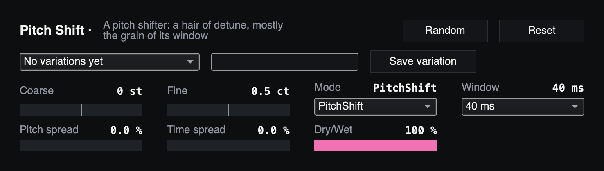

*Fig: Pitch Shift at its starting values.*

Shifts the instrument's pitch, up or down two octaves. With **Dry/Wet** at
100 % it replaces your note; lower, it plays beside it: a harmony at big
shifts, a chorus at small ones.

It has two ways to shift (**Mode**). *PitchShift*, the default, cuts the
sound into short overlapping grains and plays them faster or slower; its
grains are what **Window** and the two spreads shape. *FFT* keeps a steadier
pitch and smears attacks a little less, but its notes come about 8 ms
later. Every
change of mode or window crossfades, so you can make it while playing.

| Setting | Range | Default | What it does |
|---|---|---|---|
| **Coarse** | −24 to 24 st | 0 | The shift in semitones. 12 is an octave; big upward shifts get fizzy |
| **Fine** | −100 to 100 ct | 0.5 | The shift in cents, on top |
| **Mode** | PitchShift, FFT | PitchShift | How it shifts (above) |
| **Window** | 10 to 200 ms | 40 ms | PitchShift's grain length. Shorter smears attacks less but buzzes on low notes; longer is smoother and smears more |
| **Pitch spread** | 0 to 25 % | 0 | Each grain's pitch off by up to this much, at random. A little thickens, a lot warbles |
| **Time spread** | 0 to 100 % | 0 | Each grain starts up to this share of the window late, at random. Some breaks up the metallic sound of evenly spaced grains; a lot smears |
| **Dry/Wet** | 0 to 100 % | 100 % | Your instrument against the shifted one |

Pitch Shift is the one built-in effect that delays the sound: a little, and
more the further it shifts.

## Dual Delay

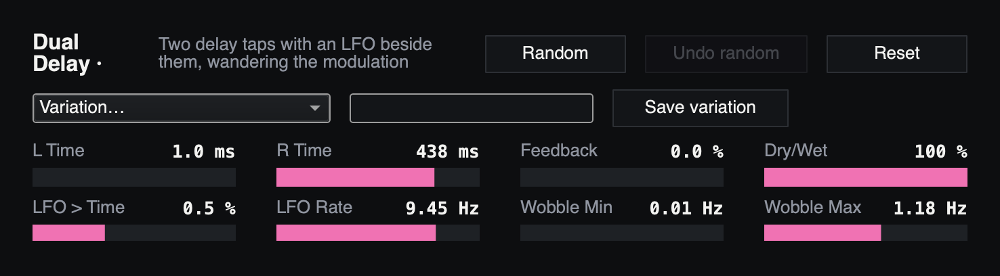

*Fig: Dual Delay at its starting values.*

Two delay taps whose times wobble, slowly and at random, in opposite
directions. At its defaults the first tap is 1 ms, a near-dry copy, and the
second 438 ms, an echo the wobble detunes: a wide, slightly seasick double
of everything you play. With **Feedback** up it becomes an ordinary
repeating delay, still wobbling.

| Setting | Range | Default | What it does |
|---|---|---|---|
| **L Time** | 1 ms to 2.5 s | 1 ms | The first tap |
| **R Time** | 1 ms to 2.5 s | 438 ms | The second tap. A change glides, so the pitch bends while you turn it |
| **Feedback** | 0 to 90 % | 0 % | Each tap back into itself |
| **Dry/Wet** | 0 to 100 % | 100 % | At 100 % only the two taps; lower keeps the plain note under them |
| **LFO > Time** | 0 to 5 % | 0.5 % | How far the wobble pulls the taps' times |
| **LFO Rate** | 0.05 to 40 Hz | 9.45 Hz | How often the wobble picks a new speed. The speeds glide from one to the next |
| **Wobble Min** | 0.01 to 10 Hz | 0.01 Hz | The slowest wobble |
| **Wobble Max** | 0.01 to 40 Hz | 1.2 Hz | The fastest wobble |

Variations: *long*, *short* and *delay*.

## Envelope Filter

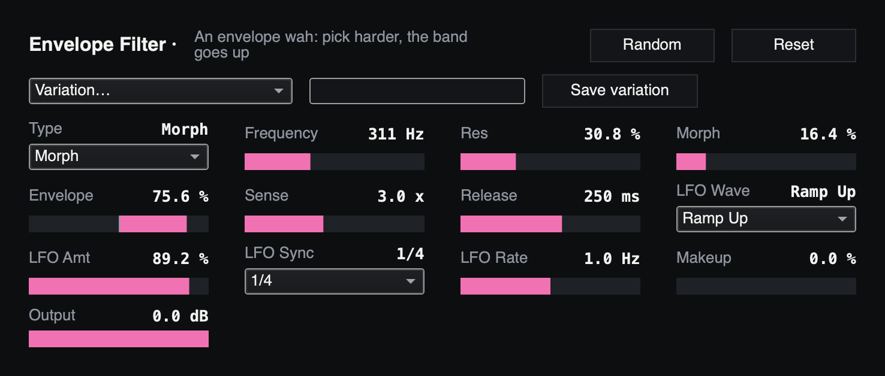

*Fig: Envelope Filter at its starting values.*

A filter that your picking opens and an LFO sweeps in time with the loop.
Every note opens it by how hard you play it, then it closes over the
**Release**; the LFO moves it once a beat on top of that. At its defaults it
is mostly a low-pass at 311 Hz, a dark quack that brightens on every pick.

All its types are 24 dB per octave. *Morph*, the default, slides from
low-pass through band-pass to high-pass as **Morph** goes from 0 to 100 %.

| Setting | Range | Default | What it does |
|---|---|---|---|
| **Type** | Low-pass, High-pass, Band-pass, Notch, Morph | Morph | The filter |
| **Frequency** | 30 Hz to 18 kHz | 311 Hz | The cutoff. The envelope and the LFO move it from here |
| **Res** | 0 to 100 % | 31 % | Resonance |
| **Morph** | 0 to 100 % | 16 % | With Type Morph: 0 % low-pass, 50 % band-pass, 100 % high-pass |
| **Envelope** | −100 to 100 % | +76 % | How far your picking moves the cutoff; 100 % is four octaves. Negative moves it down instead |
| **Sense** | 0.5 to 30× | 3× | How hard a pick has to be to reach the top of the envelope. Higher reacts to softer playing |
| **Release** | 10 ms to 3 s | 250 ms | How fast the envelope lets go after a note |
| **LFO Wave** | Sine, Triangle, Saw, Square, Ramp Up, Ramp Down, Wander, S&H | Ramp Up | The LFO's shape. Saw falls fast and settles; Ramp Down falls in a straight line. Wander glides at random; S&H jumps at random |
| **LFO Amt** | 0 to 100 % | 89 % | How far the LFO moves the cutoff; 100 % is three octaves each way |
| **LFO Sync** | Free, 1/64 to 2/1 | 1/4 | One LFO cycle per this note value at the loop's tempo, triplets (T) and dotted (D) too. It runs from its own phase, not from the bar line |
| **LFO Rate** | 0.05 to 20 Hz | 1 Hz | The LFO's speed while Sync is Free |
| **Makeup** | 0 to 100 % | 0 % | Brings a quiet filtered sound back towards the instrument's level, by up to 26 dB |
| **Output** | −24 to 0 dB | 0 dB | The level after a soft clip |

Variations: *low pass*, *notch*, *fast*, and five more by number.

## Pitch Loops

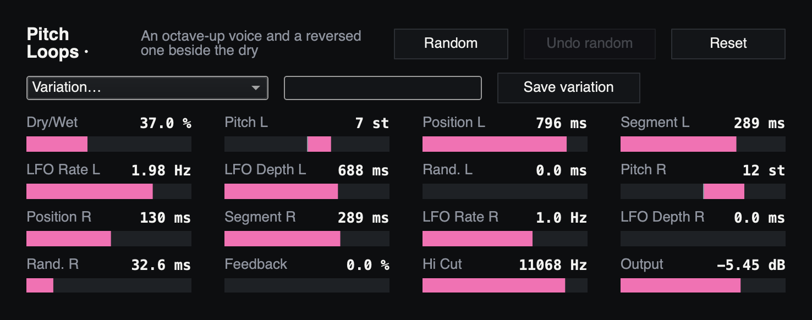

*Fig: Pitch Loops at its starting values.*

Replays pieces of the last few seconds of your playing in two voices, behind
you. The first plays each piece **reversed a fifth up**, starting about
800 ms back; the second plays it **forwards an octave up**, a little behind
you. Together they make a shimmering, backwards halo that follows what you
play.

Each voice has its own pitch, how far back its pieces start (**Position**),
how long they are (**Segment**), and an LFO and a random amount that push
each piece further back. Positions and segments are held to what fits its
six-second memory, so a low pitch with long pieces may not go as far back
as the knob says. **Feedback** puts the two voices back into the memory, so
each pass is shifted again and the sound climbs.

| Setting | Range | Default | What it does |
|---|---|---|---|
| **Dry/Wet** | 0 to 100 % | 37 % | Your instrument against the two voices |
| **Pitch L** | −24 to 24 st | +7 st | The reversed voice's transposition |
| **Position L** | 10 ms to 1.5 s | 796 ms | How far behind your playing each reversed piece starts |
| **Segment L** | 20 to 900 ms | 289 ms | How much audio each reversed piece holds; played in less as the pitch goes up |
| **LFO Rate L** | 0.01 to 10 Hz | 1.98 Hz | The sine LFO on the reversed voice's start |
| **LFO Depth L** | 0 to 1 s | 688 ms | How much further back that LFO can push a piece, taken once per piece |
| **Rand. L** | 0 to 200 ms | 0 | A random extra distance for each reversed piece |
| **Pitch R** | −24 to 24 st | +12 st | The forward voice's transposition |
| **Position R** | 10 ms to 1.5 s | 130 ms | How far the forward voice trails. A voice pitched up is held far enough back not to catch up with you (290 ms at +12) |
| **Segment R** | 20 to 900 ms | 289 ms | Audio per piece of the forward voice |
| **LFO Rate R** | 0.01 to 10 Hz | 1 Hz | The sine LFO on the forward voice's start |
| **LFO Depth R** | 0 to 1 s | 0 | How much further back that LFO can push a piece |
| **Rand. R** | 0 to 200 ms | 33 ms | A random extra distance for each forward piece |
| **Feedback** | 0 to 90 % | 0 % | The voices back into the memory |
| **Hi Cut** | 500 Hz to 18 kHz | 11 kHz | A high cut on both voices |
| **Output** | −36 to 6 dB | −5.5 dB | The two voices' level |

Five variations, by number.

## Tape Echo

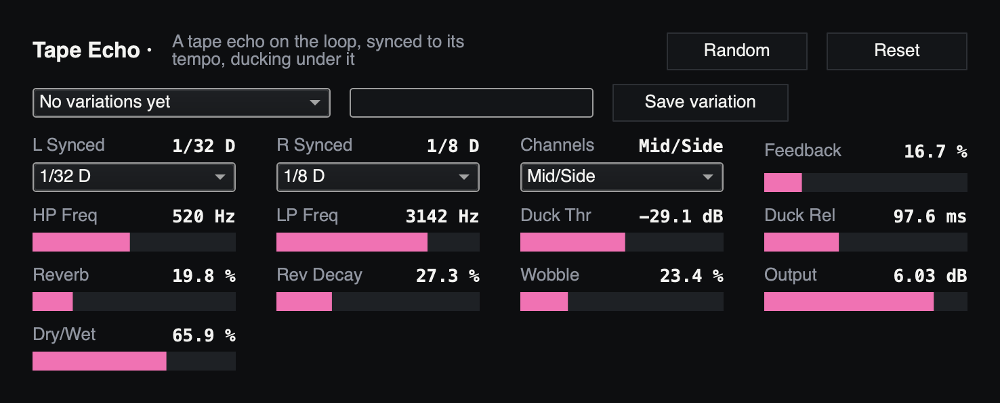

*Fig: Tape Echo at its starting values.*

An echo on the loop, timed in note values at the loop's tempo, with the
irregularity of tape. Its repeats are band-limited (only the middle,
520 Hz to 3.1 kHz, comes back), get a little reverb of their own, and
**duck** under the loop: while the loop is loud they drop by 14 dB, and they
come up in its gaps.

At its defaults it runs **Mid/Side**: the first line times the middle of the
stereo picture and the second the sides. A mono loop has no sides, so only
the first line is heard, a slap a dotted 1/32 late (about 68 ms at
165 BPM). Choose **Stereo** to hear both lines, left and right.

Its **Dry/Wet** is a plain crossfade: at the default 66 % the loop itself
drops to a third while the Tape Echo is on, and the repeats sit on top.

| Setting | Range | Default | What it does |
|---|---|---|---|
| **L Synced** | 1/64 to 1/2 | 1/32 D | The first line's note value, triplets (T) and dotted (D) too |
| **R Synced** | 1/64 to 1/2 | 1/8 D | The second line's |
| **Channels** | Stereo, Mid/Side | Mid/Side | Left and right lines, or middle and sides (above) |
| **Feedback** | 0 to 90 % | 16.7 % | How much of each repeat comes round again |
| **HP Freq** | 20 Hz to 18 kHz | 520 Hz | Cuts the lows from the repeats |
| **LP Freq** | 20 Hz to 18 kHz | 3.1 kHz | Cuts the highs from the repeats; the echo's LFO sweeps it, once every two beats |
| **Duck Thr** | −60 to 0 dB | −29 dB | While the loop is louder than this, the repeats drop. 0 dB never ducks |
| **Duck Rel** | 20 ms to 1.5 s | 98 ms | How soon the repeats come back after the loop falls |
| **Reverb** | 0 to 100 % | 19.8 % | The echo's own reverb on the repeats |
| **Rev Decay** | 0 to 100 % | 27.3 % | How long that reverb rings |
| **Wobble** | 0 to 100 % | 23.4 % | Tape-like irregularity in the time |
| **Output** | −24 to 12 dB | +6 dB | Gain on the repeats |
| **Dry/Wet** | 0 to 100 % | 66 % | The loop against the repeats, a linear crossfade |

## Drive

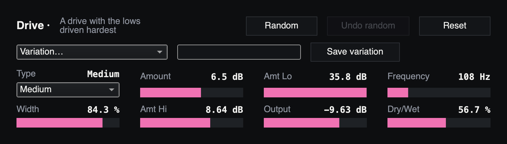

*Fig: Drive at its starting values.*

A saturation for the loop that drives the lows hardest. Before the curve it
boosts the lows a lot (**Amt Lo**) and a band around 108 Hz some more
(**Amt Hi**); after it, it takes both boosts out again. So the low notes
distort without booming, and the tone stays about where it was.

| Setting | Range | Default | What it does |
|---|---|---|---|
| **Type** | Analog Clip, Soft Sine, Medium, Hard Curve, Sinoid Fold, Digital Clip | Medium | The curve. Medium is smooth; Hard Curve and Digital Clip are harder; Sinoid Fold folds loud peaks back over |
| **Amount** | −36 to 36 dB | +6.5 dB | Gain into the curve |
| **Amt Lo** | −36 to 36 dB | +35.8 dB | How much harder the lows, below 250 Hz, hit the curve |
| **Frequency** | 30 Hz to 18 kHz | 108 Hz | The centre of the Amt Hi band |
| **Width** | 5 to 100 % | 84 % | The width of that band |
| **Amt Hi** | −24 to 24 dB | +8.6 dB | How much harder that band hits the curve |
| **Output** | −36 to 0 dB | −9.6 dB | The level after the curve. Turn it down as Amount goes up |
| **Dry/Wet** | 0 to 100 % | 57 % | The plain loop against the driven one |

Variations: *brutal*, *loop-playback*, *gut mit redux*, *obertöne*, and two
more by number.

## Crusher

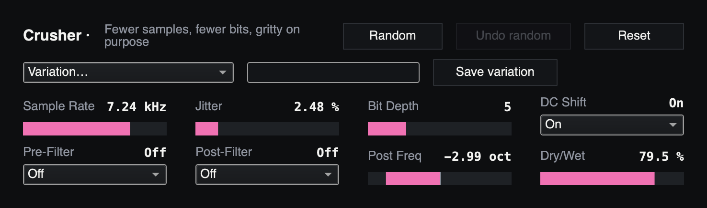

*Fig: Crusher at its starting values.*

Fewer samples and fewer bits: the loop sampled about 7,200 times a second
at 5 bits, the grit of an early sampler. The sample rate jitters a little
at random, which keeps it from sounding too clean.

| Setting | Range | Default | What it does |
|---|---|---|---|
| **Sample Rate** | 0.05 to 40 kHz | 7.2 kHz | How often the loop is sampled. Lower is grittier |
| **Jitter** | 0 to 100 % | 2.5 % | Randomness in the sample rate |
| **Bit Depth** | 1 to 16 | 5 | Fewer bits, coarser steps |
| **DC Shift** | Off, On | On | On: even silence sits half a step off zero, so quiet playing buzzes instead of cutting out |
| **Pre-Filter** | Off, On | Off | Smooths the loop before it is sampled: less fizz and fewer stray tones |
| **Post-Filter** | Off, On | Off | A low-pass after the crusher, at Post Freq |
| **Post Freq** | −4 to 4 oct | −3 oct | Where the post-filter cuts, in octaves from half the sample rate |
| **Dry/Wet** | 0 to 100 % | 80 % | The plain loop against the crushed one |

Variations: *heavy distorted*, *loop-playback*, and one more by number.

## EQ

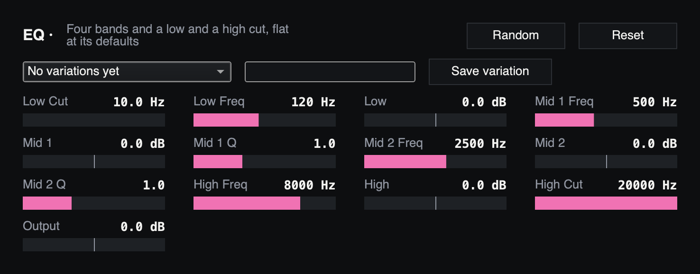

*Fig: EQ at its starting values: flat.*

Four bands and two cuts, flat at its starting values: every band at 0 dB and
both cuts out, so it passes the signal as it came until you move something. The
cuts are 24 dB an octave; each is out at the end of its knob.

| Setting | Range | Default | What it does |
|---|---|---|---|
| **Low Cut** | 10 to 1,000 Hz | 10 Hz (out) | Cuts below it: rumble, a bass's lowest boom |
| **Low Freq** | 20 to 1,000 Hz | 120 Hz | Where the low shelf turns |
| **Low** | −18 to 18 dB | 0 dB | Everything below Low Freq, up or down |
| **Mid 1 Freq** | 60 to 10,000 Hz | 500 Hz | The first middle band's centre |
| **Mid 1** | −18 to 18 dB | 0 dB | The first middle band, up or down |
| **Mid 1 Q** | 0.3 to 10 | 1 | How narrow the first middle band is; higher is narrower |
| **Mid 2 Freq** | 200 to 16,000 Hz | 2,500 Hz | The second middle band's centre |
| **Mid 2** | −18 to 18 dB | 0 dB | The second middle band, up or down |
| **Mid 2 Q** | 0.3 to 10 | 1 | How narrow the second middle band is |
| **High Freq** | 1 to 16 kHz | 8 kHz | Where the high shelf turns |
| **High** | −18 to 18 dB | 0 dB | Everything above High Freq, up or down |
| **High Cut** | 1 to 20 kHz | 20 kHz (out) | Cuts above it: fizz, hiss |
| **Output** | −18 to 18 dB | 0 dB | The level it leaves at |

## Compressor

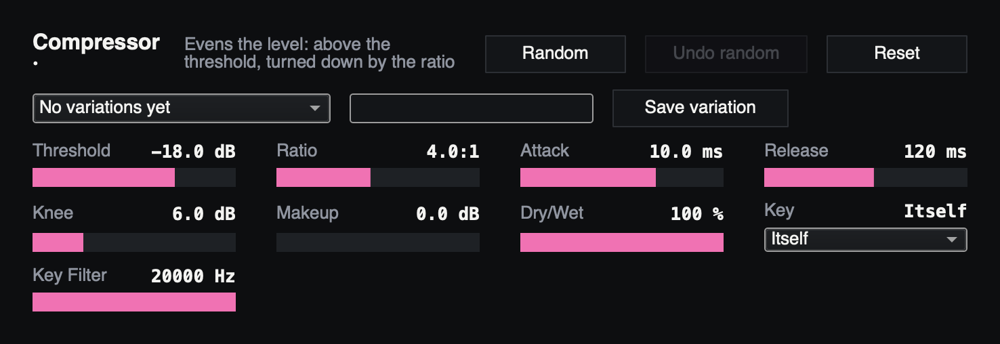

*Fig: Compressor at its starting values.*

Evens the level out: whatever goes over the threshold is turned down by the
ratio. At its starting values a note 4 dB over the threshold comes out 1 dB
over it. It has no look-ahead, so it adds no delay to what you play; above full
scale the output bends rather than runs on, should the makeup push it there.
Before Drive or a delay it evens what they hear; on the loop it holds a
take that came out uneven.

**Side chain.** **Key** says what turns it down: itself, as it starts, or
another chain. Keyed by another chain, it listens to that chain and turns its
own down:

- **On the loop, keyed by the Instrument**, the loop makes room while you play
  over it and comes back when you stop.
- **On the bass, the synth or the loop, keyed by the Drums**, it pumps on the
  kick. Turn **Key Filter** down to about 100 Hz, so only the kick's lows move
  it, not the hi-hats.

The key is the other chain after its effects and before its fader. Muting
that chain's strip leaves the key as it was, so the pumping goes on;
stopping what plays there stops it. The drums are heard before their reverb, so its tail doesn't hold the
compressor down. A chain later in the line (instrument, bass, loop, drums,
synth) is heard 64 samples late, 1.3 ms at 48 kHz, well inside an attack. Its
own chain's name in the menu is the same as **Itself**.

The looper records the instrument chain after its effects, so a keyed
Compressor there is recorded into the loop, pumping and all. For pumping you
hear but don't loop, put it on the loop, the bass or the synth.

| Setting | Range | Default | What it does |
|---|---|---|---|
| **Threshold** | −60 to 0 dB | −18 dB | Above it the level is turned down |
| **Ratio** | 1:1 to 20:1 | 4:1 | How hard. 20:1 is nearly a limiter |
| **Attack** | 0.1 to 100 ms | 10 ms | How fast it turns down. Slower lets a pick's attack through |
| **Release** | 10 to 1,000 ms | 120 ms | How fast it lets go |
| **Knee** | 0 to 24 dB | 6 dB | How gently it starts around the threshold; 0 is a hard corner |
| **Makeup** | 0 to 24 dB | 0 dB | Gain back after it |
| **Dry/Wet** | 0 to 100 % | 100 % | The signal as it came against the compressed one. Lower is parallel compression |
| **Key** | Itself, Instrument, Bass, Loop, Drums, Synth | Itself | What turns it down. Random leaves it where it is |
| **Key Filter** | 40 Hz to 20 kHz | 20 kHz (out) | Cuts the key above it, 24 dB an octave, so only its lows turn it down |

## Noise Gate

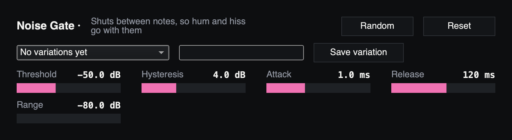

*Fig: Noise Gate at its starting values.*

Shuts when the level falls below the threshold, so hum and hiss between notes
go with it. It opens above the threshold and shuts only once the level has
fallen a few dB further (Hysteresis), so a note dying around the threshold
doesn't flutter. First in the instrument chain, before Drive, is its place.

| Setting | Range | Default | What it does |
|---|---|---|---|
| **Threshold** | −80 to 0 dB | −50 dB | It opens above it. Set it just above the hum |
| **Hysteresis** | 0 to 12 dB | 4 dB | How far below the threshold the level must fall before it shuts |
| **Attack** | 0.1 to 50 ms | 1 ms | How fast it opens |
| **Release** | 5 to 2,000 ms | 120 ms | How fast it shuts once the level has fallen. Longer lets a note ring out |
| **Range** | −80 to 0 dB | −80 dB | How far it shuts: −80 is silent, −20 lets some through |

## Freeze

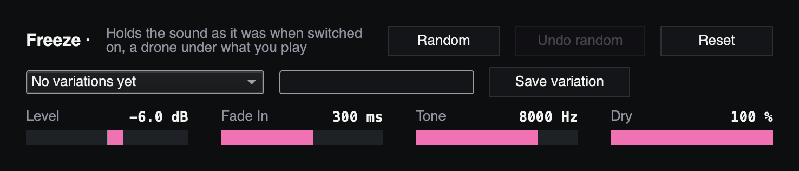

*Fig: Freeze at its starting values.*

Holds the sound as it was when you switched it on and plays it on as a drone,
under whatever you play next. Switch it on over a chord and the chord stays;
switch it off and the drone goes within 30 ms. Its switch is the freeze: map a
footswitch to it in **hold** mode (MIDI Map) and the drone lasts as long as your
foot is down. It keeps listening while off, so it always has the moment
before its switch to hold.

| Setting | Range | Default | What it does |
|---|---|---|---|
| **Level** | −24 to 6 dB | −6 dB | How loud the drone is |
| **Fade In** | 10 ms to 4 s | 300 ms | How long the drone takes to swell up |
| **Tone** | 500 Hz to 20 kHz | 8 kHz | A low-pass on the drone. Lower is darker |
| **Dry** | 0 to 100 % | 100 % | What you play, beside the drone |

## Slicer

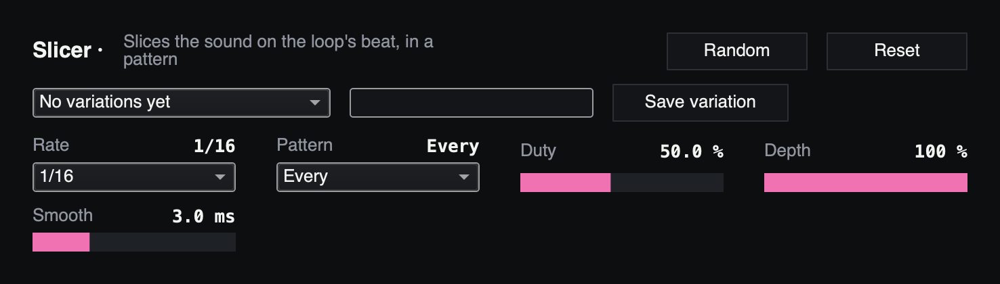

*Fig: Slicer at its starting values.*

Slices the sound on the beat: open, shut, open, shut, in a pattern of eight
slices. It slices on the loop's grid, counted from the loop's first beat, so
its slices land with the drums; with no loop playing it counts from when it
came in. At half-time it slices at the loop's pace.

| Setting | Range | Default | What it does |
|---|---|---|---|
| **Rate** | 1/16 T, 1/16, 1/8 T, 1/8, 1/4 | 1/16 | How long a slice is |
| **Pattern** | Every, On-beats, Off-beats, 3+3+2, Gallop | Every | Which of eight slices play. 3+3+2 is a tresillo |
| **Duty** | 10 to 100 % | 50 % | How much of a slice is open |
| **Depth** | 0 to 100 % | 100 % | How deep the gaps go. Lower is a tremolo |
| **Smooth** | 1 to 50 ms | 3 ms | How soft each edge is. Longer is rounder |

## Tremolo

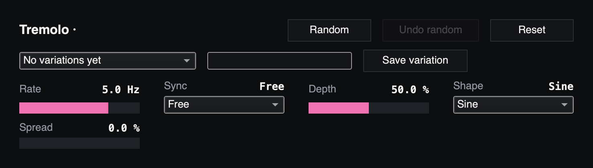

*Fig: Tremolo at its starting values.*

The level swung up and down: from full level down by Depth, Rate times a
second, or with **Sync** on a beat value, on the loop's grid as the Slicer counts
it, so its swings land with the drums. **Spread** sets the right side behind the
left: at 100 % they swing opposite, and the sound moves from side to side.

| Setting | Range | Default | What it does |
|---|---|---|---|
| **Rate** | 0.1 to 20 Hz | 5 Hz | Swings a second. Not used with Sync on a beat |
| **Sync** | Free, 1/16 T, 1/16, 1/8 T, 1/8, 1/4 T, 1/4, 1/2 | Free | A swing every so much of a beat, on the loop's grid |
| **Depth** | 0 to 100 % | 50 % | How far down it swings. 100 % is to silence |
| **Shape** | Sine, Triangle, Square | Sine | The swing's shape. Square chops |
| **Spread** | 0 to 100 % | 0 % | The right side behind the left. 100 % swings them opposite |

## Octave Down

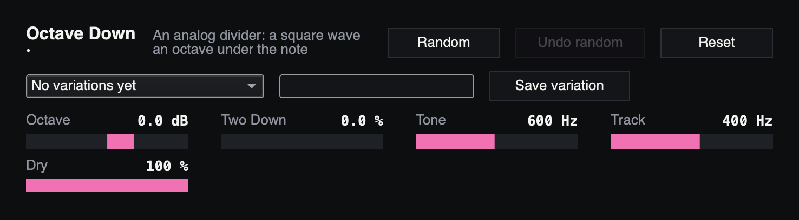

*Fig: Octave Down at its starting values.*

An analog octave divider: it follows the note's zero crossings and plays a
square wave an octave below it, at the note's level, filtered. Like a pedal's,
it tracks one note at a time best; a chord gives it a growl. A second divider
gives two octaves down beside it.

| Setting | Range | Default | What it does |
|---|---|---|---|
| **Octave** | −24 to 12 dB | 0 dB | The octave below |
| **Two Down** | 0 to 100 % | 0 % | Two octaves below, beside it |
| **Tone** | 100 Hz to 4 kHz | 600 Hz | A low-pass on the divided octave. Higher is buzzier |
| **Track** | 80 Hz to 1.5 kHz | 400 Hz | What it listens to for the note. Lower tracks low notes cleaner, higher the high ones |
| **Dry** | 0 to 100 % | 100 % | The note as played, beside the octave |

## Ring Mod

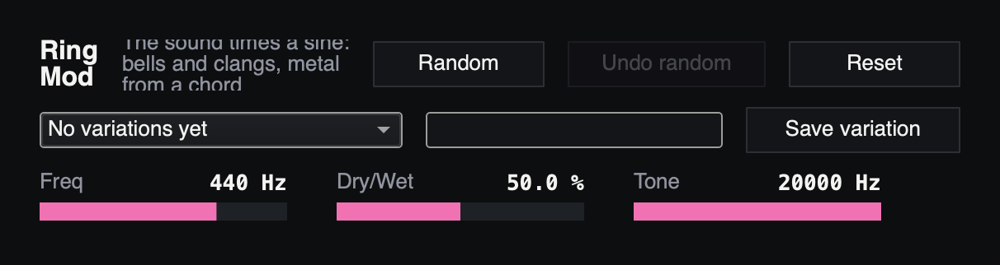

*Fig: Ring Mod at its starting values.*

The sound times a sine: every note turns into the sum and the difference of its
frequency and the sine's, bells and clangs, metal from a chord. Below about
20 Hz it is a tremolo instead.

| Setting | Range | Default | What it does |
|---|---|---|---|
| **Freq** | 1 Hz to 5 kHz | 440 Hz | The sine's frequency. Low is a tremolo, high is bells |
| **Dry/Wet** | 0 to 100 % | 50 % | The sound as it came against the modulated one |
| **Tone** | 500 Hz to 20 kHz | 20 kHz | A low-pass on the modulated sound |

## Reverb

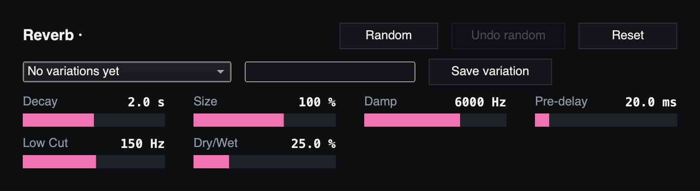

*Fig: Reverb at its starting values.*

A room to a hall, megalooper's own: the sound and its tail, which falls 60 dB in
Decay seconds whatever the Size. The highs die sooner than the lows, above Damp;
the lows below Low Cut stay out of the tail, so they stay clear. It keeps
running while off, so a tail it holds is heard when it comes back on, and it
does not cut a tail short when the loop stops.

| Setting | Range | Default | What it does |
|---|---|---|---|
| **Decay** | 0.2 to 20 s | 2 s | How long the tail takes to fall 60 dB |
| **Size** | 30 to 200 % | 100 % | How big the space sounds. Small is a room, big a hall |
| **Damp** | 500 Hz to 20 kHz | 6 kHz | Above this the tail dies sooner. Lower is darker |
| **Pre-delay** | 0 to 200 ms | 20 ms | How long before the tail starts |
| **Low Cut** | 20 Hz to 1 kHz | 150 Hz | What goes into the tail, cut below this |
| **Dry/Wet** | 0 to 100 % | 25 % | The sound as it came against the reverb |
