# megalooper: the manual

Installing megalooper and the first run are in the [README](../README.md).
Megalooper SA's effect chains, sounds and plugins are in
[Megalooper SA](standalone.md), and the drums' kits in [Drums](drums.md).

This manual is the reference for everything else: the rigs, every control,
the MIDI map, the onset notes, the grains, the cutter, calibration, how the
meter is found, and the tests. Some of it was written for the rig megalooper
grew up on (the TSMega floor controller and a Faderfox UC4), and says so where
it is about that rig.

## Configuration

Choose the audio in the Desktop launcher, before you start:

| Menu | What it is |
|---|---|
| **Input** | The device your instrument comes in on. **System default** follows the Mac's Sound settings |
| **Output** | The device the mix plays on, on its outputs 1 and 2 |
| **Instrument** | The input your instrument is plugged into. The looper records it through the Instrument chain and listens to it dry for the meter |
| **Bass** | **None**, or the input a bass is plugged into: it gets a chain and a strip of its own ([A bass](routing.md#a-bass)) |
| **Buffer** | The audio buffer. Bigger stops dropouts on a slower computer, and adds delay |

megalooper keeps your choice in `settings.json` for the next start. A device
that is not plugged in then gives way to the system's default, and the
launcher says so. The same menus are on Setup's Rig page, where **Apply and
restart** starts megalooper again on a change. What the Calibrate view
measures is kept for each setup (the devices and the buffer), and a setup on
the device of a rig of yours starts from that rig's numbers and MIDI map
([The calibrated values](routing.md#the-calibrated-values)).

Behind the menus is megalooper's one **routing profile**, **`saSystem`**:
Megalooper SA, with its effect chains, drums and synth. With nothing chosen
it names no device, and SuperCollider opens whatever CoreAudio is currently
defaulting to, so it is right on any Mac with nothing to set up. From the
editor it is one line in `scripts/setup-routing.scd`, and the choice made in
the launcher still applies:

```supercollider
~defaultRoutingProfile = \saSystem;
```

Two things to know before the first loop. **Use headphones**: the looper plays
back while it records, so built-in mic into built-in speakers is a feedback
loop. And **the input and output must run at the same sample rate** —
scsynth refuses to boot otherwise, and a stock Mac often has the microphone at
44.1 kHz and the speakers at 48 kHz. megalooper checks this before booting,
names both devices, and for the system's defaults there is one command that
fixes it (for two devices you chose, set them to one rate in Audio MIDI Setup):

```bash
python3 tools/coreaudio.py defaults             # do they agree?
python3 tools/coreaudio.py match-default-rates  # make them agree
```

`tools/coreaudio.py` is a standard-library-only CoreAudio bridge — no
dependencies, no build step. It also lists devices with their real channel
counts (`list`), shows one in full (`inspect`), and cross-checks every reading
against `system_profiler` (`selftest`). `list` output is the right thing to
paste into a bug report.

**Rigs of your own** are for what the menus do not offer: an aggregate
device, a sample rate switched before the start, several fixed setups. They go
in `profiles.scd` in your megalooper folder, never in the repository, and the
launcher then shows a **Rig** menu offering each beside `saSystem`, which
says its own device and inputs.
[Adding a rig](routing.md#adding-a-rig) says what each field means and how to
write one.

## Running

### From the Desktop icon

The installer builds the app. Rebuild it after moving the folder:

```bash
./tools/make-app.sh            # builds ~/Desktop/megalooper.app
./tools/make-app.sh /Applications   # or somewhere else
```

Double-click it and a small window opens: pick the rig from the dropdown and
press **Start megalooper**. A ✓ next to a profile means that rig's audio device
is connected right now, so a missing interface is visible *before* the boot
rather than as an aborted boot. **Rescan** re-checks CoreAudio if you plug
something in after opening the window. **Buffer** sets the audio buffer: leave
it at *as the rig sets it*, or pick a bigger one (256 frames) on a slower
computer that clicks or drops out. It adds as much delay (5 ms each way at
48 kHz), so run the latency step on the Calibrate view after changing it. The
chosen rig and buffer are remembered for next time, and closing the window
quits the app and the server.

The bundle is a thin wrapper around `scripts/launcher.scd` with the repo path
baked in — nothing is copied, so script edits take effect on the next launch
with no rebuild. **Moving the repo breaks it; re-run `make-app.sh` after a
move.** macOS warns once because the bundle is unsigned: right-click → Open →
Open. There is no post window under the icon, so all output goes to
`~/Library/Logs/megalooper.log`, and boot failures also appear in the launcher's
status line.

On a screen smaller than 1440 × 900, `./tools/megalooper` scales the window
down to fit (`MEGALOOPER_SCALE=1` turns that off); the Desktop icon does not.

### From the SuperCollider IDE

Open `scripts/boot.scd` and evaluate the parenthesized boot block (place the
cursor inside, press `Cmd+.` first if a server is already running, then
`Cmd+Return`). The rig here comes from `~defaultRoutingProfile` in
`scripts/setup-routing.scd` — the launcher's choice only applies when launched
from the icon.

`boot.scd` is only an orchestrator: it picks the routing profile, loads the
part-files beside it, and calls their builders in order. Re-running it rebuilds
everything — including freeing the `Looper`, which **destroys the recorded
loop**. To iterate on one part without losing the loop, re-evaluate that part's
file and call its builder:

```supercollider
~buildGuiWindow.();       // rebuild the whole window, loop untouched
~buildBBCutPane.();       // rebuild ONE pane in place; the status band, the
~buildGranularPane.();    // other panes and the running audio are untouched
~buildAnalysisPane.();
~buildPerformPane.();
~buildRigPane.();
~buildMidiPane.();
~buildCalibratePane.();
~buildEffectsPane.();
~buildDrumsPane.();
~buildSynthPane.();
~wireLooperController.(); // re-subscribe the GUI after rebuilding a pane
~setupMidiBindings.();    // rebuild the MIDI router's map and responders
```

A pane rebuild swaps a fresh `View` into its holder inside the window's
`StackLayout`; the stack's own children are built once and never touched, so the
tabs cannot drift out of step with what they are showing.

After editing anything under `scripts/`, run the static check — it parses and
loads every file without booting a server, opening a window or touching MIDI:

```
/Applications/SuperCollider.app/Contents/MacOS/sclang scripts/check.scd
```

Wait for the post window to print `Boot complete.`: the `megalooper` window
opens on the Perform view (see [GUI](#gui)).

## Controls

### Keyboard (the megalooper window must be focused)

| Key | Action                                                            |
|-----|-------------------------------------------------------------------|
| `R` | Multi-purpose trigger (record → play → overdub → play → ...)      |
| `S` | Stop                                                              |
| `M` | Multiply loop length (×2)                                         |
| `U` | Undo (one level deep)                                             |
| `V` | Reverse                                                           |
| `L` | Half-time: the loop at half speed from the next loop; again ends it with the pass |
| `G` | Grains on and off                                                 |
| `B` | Cutter on and off                                                 |
| `K` | Break: silence until a loop downbeat                              |
| `D` | Dissolve: run the ending; again aborts                            |
| `N` | Rec next loop                                                     |
| `C` | Clear                                                             |
| `A` | Next reading — the analyser's runner-up meter, then the one after; lands on a loop boundary |
| `E` | Export the loop as training data                                  |
| `Cmd+M` | MIDI Map mode on and off — see *Mapping your own controller* |

`1`–`7` show the views, `T` switches the theme and `H` the help lines (see
[GUI](#gui)). On the FX view, Cmd+Z undoes a chain edit and Shift+Cmd+Z redoes
it.

A letter with Cmd or Ctrl held is no shortcut: Cmd+C doesn't clear. In MIDI
Map mode the letters still work, and Esc, Delete and Cmd+Z join them.

The `R` trigger cycles:

```
empty -> record  ->  play  ->  overdub  ->  play  ->  ...
                                  ^                       |
                                  +-----------------------+
stopped -> play
```

**Rec next loop** (`N`) records a new loop while this one plays: your
instrument plus the loop after its effects. Press it and it starts on the next
loop boundary. Press again to stop at the end of that pass; it keeps a whole
number of repetitions. Pressed before it starts, it cancels. It needs a loop
playing, not overdubbing.

### MIDI

Which message does what is a **MIDI map**, and a control can be put on any
controller: see *Mapping your own controller* below. A fresh install starts
with no map at all, so a stranger's keyboard does nothing until it is mapped:
map your own controller in MIDI Map mode, or pick the one map megalooper
ships, **keys-and-knobs**, in Setup's MIDI map. A rig of yours may name a map
of yours to start with (its profile's `midiMap:`).

**A pedal's flicker.** An expression pedal can hop one step back and forth on
its own when nobody touches it (one at rest can read 68, 69, 68). So every
knob or pedal on a CC has one step of hysteresis unless its mapping says
otherwise: a move counts if it is two steps or more, or one step on in the
direction of the last. The control stays within a step of the pedal, and a
threshold set with the Onset macro is not taken back by the next hop. The
Knobs row of Setup's MIDI map sets the default.

**keys-and-knobs**, for keyboards and knob boxes, on any input:

| Message | Action |
|---|---|
| Note On 60–65 | Trigger, Stop, Multiply, Undo, Reverse, Clear |
| Note On 66 | Cutter on and off |
| Note On 67 | Record next loop |
| Note On 68 | Break |
| Note On 69 | Dissolve — run the ending; press again to abort |
| Note On 70 | **Record the set** |
| Note On 71 | **Next reading** |
| CC 11 | **Arc / intensity** — expression pedal. Drives the granular level and the cutter's density: heel = the dry loop with a cutter that barely chops and no grains, toe = everything as dialled in |
| CC 40–47 | The Grains' Pitch, Grain and Read position sections (Sound) — see below |
| CC 118 | The Grains' Morph (0 = frozen drone, 127 = pulsed scan) |
| CC 119 | The Grains' Level |

**CC 40–47** is one contiguous block covering three of the four sections of the
Grains, in the order they list them — so a bank of eight knobs
lands on it without anything to remember:

| CC | Control | Section |
| --- | --- | --- |
| 40 | Pitch (−24…+24 semitones, 64 = unison) | Pitch |
| 41 | Detune (redrawn per grain) | Pitch |
| 42 | Grain size (×, 64 = morph untouched) | Grain |
| 43 | Density (×, 64 = morph untouched) | Grain |
| 44 | Size rand | Grain |
| 45 | Position — where in the loop grains come from | Read position |
| 46 | Scan — how the read point moves | Read position |
| 47 | Spray | Read position |

Every knob binding uses the **same law as its control's widget**, so a fader
sweep and a mouse drag cover the same range in the same shape.

#### Mapping your own controller

**MIDI Map mode**. Press **MIDI MAP** in the top bar (on every
view), or Cmd+M. Every control in the window is outlined in blue and says what
drives it ("note 60"). Click one, and move a knob or press a switch on your
controller: that now drives it. Shift-click instead adds one more, so a control
can answer two switches. While a control waits, its mask is amber and counts
down its 15 s, and so does the map bar above the footer. Esc cancels, and
pressed again leaves. **Delete** (or the Delete key) takes the waiting
control's MIDI away, and Cmd+Z or **Undo** brings it back.
**Keep** keeps the map, and **Done** leaves; with changes not kept it asks
first: Keep, Discard or Later. The controls don't move while map mode is on.
MIDI goes on driving everything until you click a control.

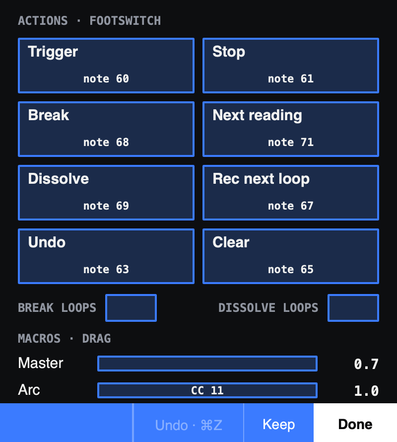

*Fig: MIDI Map mode with the shipped keys-and-knobs map: each control says what drives it, note 60 for Trigger, CC 11 for the Arc macro.*

Everything else is in the **MIDI map** section of Setup's MIDI & AI page, including
the controls that have no widget, such as the
views themselves (Show Perform, Show Sound, …, to put them on footswitches):

- **Inputs**: every MIDI input there is, each a switch: whether megalooper
  listens to it. One switched off reaches no control. Plugged in after the boot? Press **Rescan**.
- **Send back**: for a controller that takes MIDI back, such as the Faderfox
  UC4, whether megalooper sends it where each control it drives is. An encoder
  then goes on from where the mouse or a preset put its control, with no jump,
  and a button's light shows its switch. A knob is never sent its own moves,
  and not while it is being turned. Off until you switch it on. Unplugged and
  plugged in again, a controller shows its own values until you press
  **Rescan**.
- **Map**: which map this rig uses; the choice is kept per rig. **Keep** writes
  it as yours, and the next boot starts with it. Nothing is written before
  Keep. **Undo** takes the last change back. **Revert** goes back to what was
  kept, and **Reset to shipped** to the map as megalooper ships it (yours goes
  into the backups); both ask for a second click. **Load from…** opens a map
  file, a backup or one someone sent you.
- **The list**: every binding, with its range where it has one. A row is grey
  when its control isn't on this rig: the bass's level on a rig without a
  bass, say. Select a
  row to change it:
  - **Learn** arms its control again;
  - **×** removes the binding;
  - **Set Min** and **Set Max** take the control's value as it is now: put it
    where that end of the knob should be, then press;
  - **Swap** turns the knob round;
  - the channel and the input it answers;
  - for a CC on a switch, what kind of switch it is (one message a press, or
    press and release);
  - for a toggle, whether a press flips it, holds it on, or it follows the
    switch;
  - for a knob or pedal: its **takeover**, its hysteresis, and its **input
    range**. Takeover is what the knob does when its control is somewhere
    else, because the mouse or a preset moved it. The control **jumps** to the
    knob, as it always did. Or it waits until the knob gets to it (**picks
    up**). Or the two meet at the ends (**scales**). For the input range, press
    **Sweep**, move the pedal from one end to the other and press Done; a
    pedal that stops at 126 then still takes its control to the end. A sweep
    left running ends itself 20 s on and changes nothing. **Full** gives back
    the whole travel.
- **Knobs**: the takeover and the hysteresis of every knob mapping that
  doesn't say: jump to the knob and one step, unless you change them.
- **Add a mapping**: pick a pane and a control, press **Learn**, then move a knob
  or press a switch. On the way:
  - a CC switch is pressed twice, which tells one that sends a message a press,
    like many floor controllers, from one that sends press and release;
  - a knob counts once it has moved 3 steps, so a resting pedal's flicker is
    never learned;
  - if the message already drives another control, the section asks: **Move it
    here**, **Both** or **Cancel**;
  - while a control is learning, up to 15 s, MIDI drives nothing. Once it counts a switch's presses, up to 4 s more, only
    that switch is held back.

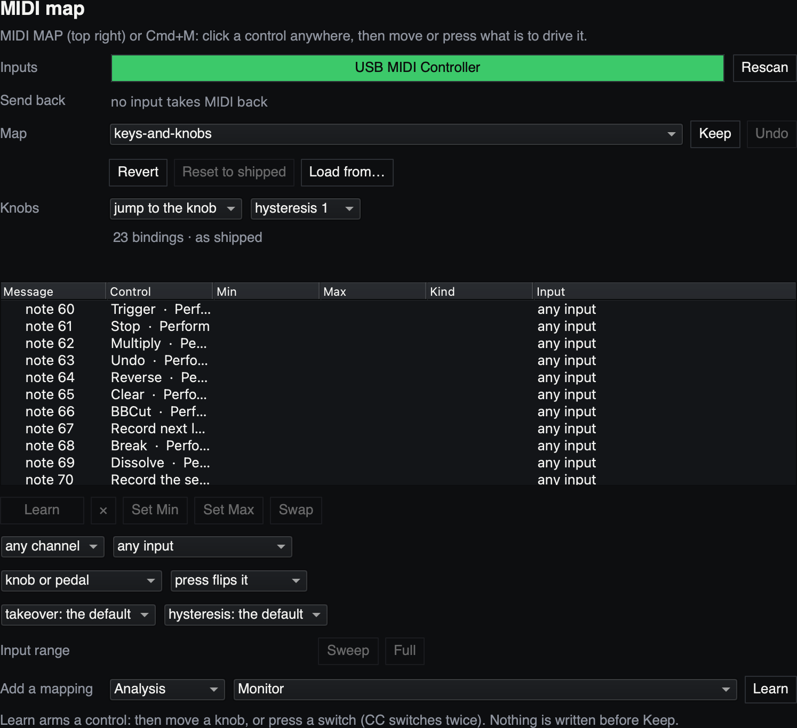

*Fig: The MIDI map section with the shipped keys-and-knobs map: the input, the map, the Knobs defaults, a row per binding, and the chosen binding's settings under the list.*

Yours live in `midi/` in your megalooper folder ([Where your files
are](../README.md#where-your-files-are)), outside the repo and shared by every
checkout. The last five Keeps of each map
are in `backups/<map>/`, and `settings.json` beside the folder holds each rig's
choice, the inputs switched off or sent back to, and the Knobs row's defaults
(they don't travel with a map). Keep makes the map this rig's choice; on a
rig with no map yet it is called "mine". If the input a map is for is switched
off or not connected, the footer's status line says so. If your map can't be read at boot, its newest
readable backup is loaded, never the shipped map: a different layout could put
Clear on a switch you now use for something else. With no backup there is no
map, and the footer says the footswitches are off. A map is JSON, data only:
[MIDI map files](midi-maps.md) has the format.

All MIDI input is logged to the post window by default, a message held back
marked as such. To silence the log, evaluate `~midiLog = false` in SC.

**One router.** Every message goes through one router
(`scripts/setup-midimap.scd`): to the controls bound to it, then into the log.
`~setupMidiBindings.()` rebuilds it, and
keeps a map's changes not kept yet.

On a Mac with the IAC Driver switched on (Audio MIDI Setup), megalooper also
sends its MIDI clock and transport there, for other apps on the Mac, and
passes every message from your controllers on to it. `~midiProxy = false`
stops the passing on.

### The arc — intensity and dissolve

Two axes over the same three levels (the dry loop, the cutter, the granular
layer), for shaping a piece without taking a hand off the instrument.

**Intensity** is the expression pedal's control (CC 11 in the keys-and-knobs map;
map any pedal to it in MIDI Map mode), mirrored by the **Arc** macro on
Perform. Heel is the dry loop with a cutter that is running but barely
chopping and no grains; toe is the cutter chopping as you dialled it in and the
granular layer at its set level.

**Dissolve** is the ending. Arm it with the Dissolve button, key `D`, or a
footswitch mapped to it, and it runs over **Dissolve loops** (Perform, 1–32
passes of the loop from the press, default 4: passes, as a break counts them,
whatever bars the analyser read), so both hands are free for the last melody; press
again to abort and restore. Things leave in the order that sounds like a piece
ending rather than like a fader going down — **the cutter first, then the body
of the loop, and the granular haze last.**

Intensity moves two things: the **level of the granular layer**, and **how much
the cutter is chopping**. The cutter's own level is not one of them — it was
until 2026-10-05, and a cutter thinned to a few repeats *and* turned down read
as the layer going away rather than as it chopping less, so now only the
dissolve takes the cutter's level out. Each cut procedure names one parameter
the pedal drives — **Cut chance** for Break/Repeat, **Stutter** for
BBCutProc11, **RollPr** for ChooseCutProc — scaled from that parameter's own floor up to
whatever you set. So at the heel Break/Repeat never breaks the loop up at all,
and at the toe it does exactly what you dialled in. WarpCutProc1 and SQPusher1
read their parameters once at build time, so the pedal does not reach them at
all; driving them would rebuild the cutter on every message.

That means **the Cutter pane's slider shows the value at full arc**, not
necessarily what is running. The arc-driven row carries a live `arc 0.20`
reading beside it so both numbers are visible at once.

Both axes are **multipliers, never replacements**. The per-voice cutter mix, the
granular level and every stored parameter stay exactly where you set them, so
their own controls keep meaning what they say while the arc moves over the top —
and presets save what you dialled in, not what the pedal happened to be doing.

Intensity **defaults to 1**, so a rig with no expression pedal connected behaves
exactly as it did before this existed — the pedal takes over the moment it is
touched and never before.

### Half-time

Press **Half-time** (Perform's Loop column, key `L`, or a switch mapped to
`looper.halfTime`) and on the next loop boundary the loop drops into half
time: half speed, an octave down, each pass twice as long, under drums, synth
and effects that keep their tempo. Every loop event still lands on the drums'
grid, at half the density. Press again and it ends with the half-speed pass,
back at full speed on the boundary after it.

- **Armed, on, ending.** The tile says `½ armed` until the boundary, `½ HALF`
  while it plays, `½ ending` until the pass is out. A press before the
  boundary takes the arm or the ending back. Within 50 ms of a boundary a
  press goes to the boundary after, as the loop couldn't be told in time.
- **On the sample.** The loop takes the new speed on the sample it starts
  again, however late the press reached it, so both edges are the loop's own
  boundaries and the drums stay on its grid through it.
- **The count** counts in to both edges (`HALF-TIME IN`, `FULL TIME IN`), and
  at half-time counts the loop's own bars, each now two drum bars long, with
  `½` beside the bar in the header and in the count's caption.
- **What follows it:** a break lasts the rest of the pass at half speed, then
  whole half-speed passes; a reading lands on the end of a half-speed pass; the
  onset kit plays the loop's hits at half density; the chords change at half
  pace. The **cutter** comes in again on each edge at the loop's speed: at
  half-time its cuts play an octave down and twice as long, on the loop's
  grid. The **grains** scan as the loop moves, and their pulse at full morph
  is the loop's pulse, twice as long; their pitch is their own, as granular
  pitch always is. A **dissolve** counts its bars at the speed it starts at.
- **Not with it:** overdub, Rec next loop, multiply and undo are refused at
  half-time, and half-time is refused while you overdub, record the next loop,
  while the cutter is starting or a dissolve runs. The footer says why. With
  the cutter on, half-time needs half a second before a boundary to land on it
  (the cutter is rebuilt for the new speed); a press later lands on the next.
- Stop and clear end it; the next start plays at full speed.

### Breaks

Hit the Break button, key `K`, or a switch mapped to it, and the looper goes
silent so the room can play into the hole, coming back **on a loop downbeat**.

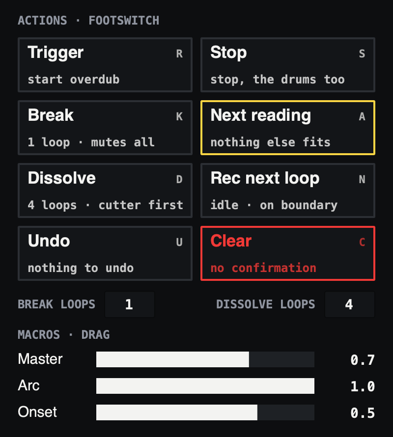

*Fig: Perform's actions with their keys. Under them, how many loops a break lasts and how many bars a dissolve takes, then the macros.*

The hole opens the instant you stomp — the mute is not quantised, so it lands
exactly where your foot did. Only the **resume** is on the grid: it waits out
whatever is left of the pass you struck it in, plus `breakLoops` - 1 further
whole loops (1–8, default 1). The pass you struck it in counts as the first one,
so the default comes back on the **next** loop downbeat, and the loop always
returns at the top of a phrase rather than somewhere in the middle of one.

That means a one-loop break lasts anything from a hair to a full pass, depending
on where your foot landed: stomp just after a downbeat and you get nearly a whole
loop of room, stomp just before one and the hole is barely there. When you want a
guaranteed full pass of silence no matter when you hit it, ask for 2 (Perform's
BREAK LOOPS). The state block wears the Break hatch and counts down the seconds
remaining, and so does the Break tile, so you always know when it is coming
back. A deliberate silence then never looks like broken audio.

It **mutes, never stops**: the engine and the drums' clock are untouched, so the
loop comes back precisely where it would have been.

**The drums change with it**, so the room hears something change rather than
only something leave: the step sequencer switches to its **Break** pattern for
exactly the break's length, and the Main pattern is back on the downbeat with
the loop. Edit the Break pattern on the Drums view.

A break silences everything the looper makes, the onset notes and the synth's
note sequence included. (Main | BREAK switched by hand on the Drums view
changes the drums' pattern only.)

### GUI

megalooper is **one window**, laid out for a laptop screen (1440 × 900) and read
from playing distance: a top bar, Perform's status band, six views (Perform,
Sound, FX, Drums, Synth and Setup) plus Calibrate, and a footer.

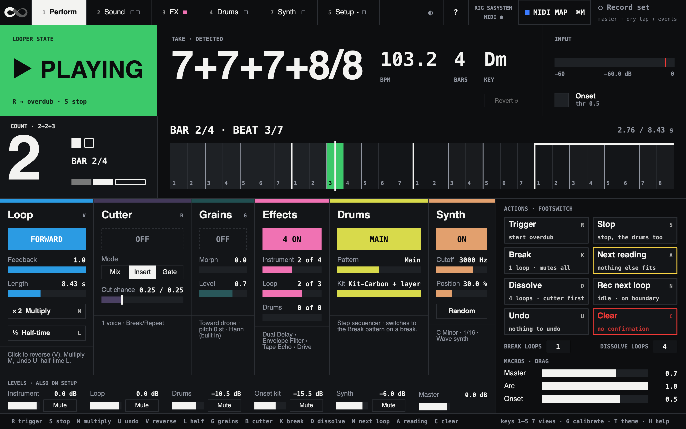

*Fig: The Perform view with a take playing: 7+7+7+8/8 at 103.2 BPM in Dm, the playhead in bar 2, beat 3, which the count under the state block shows as group 2 of 2+2+3. Under the status band, a column per layer, then the actions and the macros.*

```
┌────────────────────────────────────────────────────────────────────────────────┐
│ ∞ MEGALOOPER │ 1 Perform │ 2 Sound ■□ │ 3 FX │ 4 Drums │ 7 Synth │ 5 Setup ▾   │  the top bar
│ CPU 14% peak 21% │ ◐ │ ? │ RIG SASYSTEM MIDI ● │ ■ MIDI MAP ⌘M │ ○ Record set  │
├────────────────┬──────────────────────────────────────────┬────────────────────┤
│ LOOPER STATE   │ TAKE · DETECTED                          │ INPUT              │
│ ▶ PLAYING      │ 7/8   103.2   2   Dm                     │ ▇▇▇▇▇▇▇▇▇░░ -9 dB  │  the status band
│ R → overdub    │ [or 7/4 @ 206.4?] close call: press A    │ ■ Onset thr 0.50   │  (Perform only)
├────────────────┼──────────────────────────────────────────┴────────────────────┤
│ COUNT · 2+2+3  │ BAR 2/2 · BEAT 3/7                            2.44 / 8.14 s   │
│ 2  ■□  BAR 2/2 │ │1 2┊3 4┊5 6 7│1 2┊▓ 4┊5 6 7│ ← the beat that plays           │
│ ▬▬ ██ ▭▭▭      │    ┊ a group's head; every other group shaded                 │
├──────┬────────┬┴───────┬─────────┬───────┬───────┬─────────────────────────────┤
│ Loop │ Cutter │ Grains │ Effects │ Drums │ Synth │ ACTIONS · FOOTSWITCH        │
│[FWD] │ [ON]   │ [OFF]  │ [2 ON]  │[MAIN] │ [OFF] │ Trigger  Stop  Break        │  Perform
│ ...  │ ...    │ ...    │ ...     │ ...   │ ...   │ Next reading  Dissolve      │
│      │        │        │         │       │       │ Rec next loop  Undo  Clear  │
│      │        │        │         │       │       │ MACROS · Master  Arc  Onset │
├──────┴────────┴────────┴─────────┴───────┴───────┤                             │
│ LEVELS · Instrument Bass Loop Drums Onset kit Synth Master (as on Setup)       │
├──────────────────────────────────────────────────┴─────────────────────────────┤
│ keys 1–5 7 views · 6 calibrate · T theme · H help     Refused: nothing playing │  the footer
└────────────────────────────────────────────────────────────────────────────────┘
```

- **The top bar**, on every view: the logo, a Möbius loop whose twist
  travels round once a pass while the loop plays (and stands when it
  stops), the views' tabs (keys **1–5** and **7**, and **6**
  for the Calibrate wizard, which has no tab; each tab's squares light in its
  parts' colours while they run), the server's **CPU** (the average, with
  "peak N %" under it; red when the peak passes 60 %), **◐**
  (dark or light, key **T**, kept for the next boot; with the loop
  stopped, since the rebuild holds the language for 65–80 ms), **?** (the help lines: the sentences that explain a page, hidden
  or shown together, key **H**, kept for the next boot), the rig
  (`RIG SASYSTEM`) and a lamp for MIDI arriving,
  **MIDI MAP** and **Record set** — the set recorder, with what it writes
  under it.
- **The status band**, on Perform: the **state block** (`EMPTY`, `● REC`,
  `▶ PLAYING`, `● OVERDUB`, `■ STOPPED`, filled in the state's colour, and the
  Break hatch while a break is open) with what R does next; the **take** —
  signature, BPM, bars, key, and the reading chip (`or 7/4 @ 206.4?` on a close
  call, `→ 7/4 @ 206.4 BPM · 2 bars · lands in 1 loop` while a reading is
  armed) with **Revert**;
  the **input** — the level in dB and the **onset lamp**; under the state
  block the **count**, the beat group the loop is in, big, with the count-in
  before an event; and beside it the **bar grid**, a cell per beat with the
  bar lines in ink, the beat groups marked and the beat under the playhead
  filled. On every other view it folds into a 56 px **strip** — state, take,
  position, lamp and meter — so they never leave the screen.
- **The views**:

| View | Key | What lives there |
|---|---|---|
| **Perform** | 1 | A column per layer — **Loop** (forward/reverse, feedback, length, ×2), **Cutter** (on/off, Mix/Insert/Gate, the arc-driven parameter with its tick), **Grains** (on/off, morph, level), **Effects**, **Drums** and **Synth** (on/off, Cutoff, Position, Random) — then the **actions** (Trigger, Stop, Break, Next reading, Dissolve, Rec next loop, Undo, Clear, each with its key and footswitch), Break loops and Dissolve loops, and the **macros**: Master, Arc, Onset |
| **Sound** | 2 | The **Cutter** (preset, voices, procedure, cut synth, ratio, parameters, level, pan, voice effects) beside the **Grains** (preset, Blend, Pitch, Grain, Read position, grain window) |
| **FX** | 3 | The **effects** chains (click a block to edit it, its square to switch it) and their sounds |
| **Drums** | 4 | The **drums** (step sequencer, timing, kits, mix) |
| **Synth** | 7 | The note sequencer, the Wave synth or a VST instrument, and their presets ([The synth](synth.md)) |
| **Setup** | 5 | Three pages, picked from the menu its tab opens (key **5** again: the next page). **Rig**: profile, device, analysis input, input, Drums follow the loop, the timing bars, the levels and New loop, and **Calibrate** (where the wizard is) beside them · **Analysis**: monitor, counts, threshold, overdub detection, onset notes, pitch, fallback meter, bars by hand, export · **MIDI & AI**: the MIDI map, **MIDI in**, and **AI apps** ([AI apps](ai.md)) |
| **Calibrate** | 6 | The wizard, step by step; Esc goes back to Setup's Rig page |

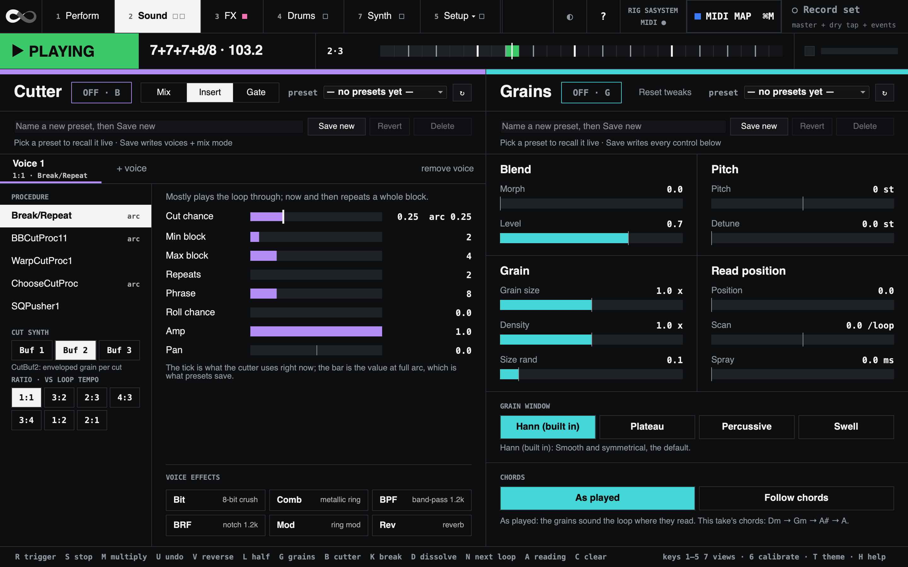

*Fig: The Sound view (2): the Cutter on the left, the Grains on the right.*

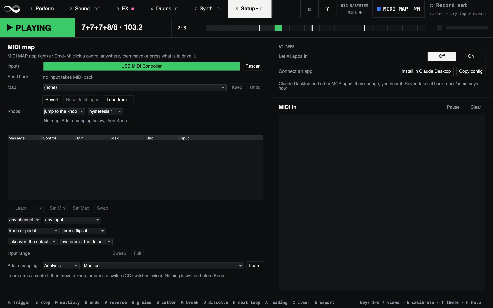

*Fig: Setup's MIDI & AI page on a fresh install: the MIDI map, still empty, AI APPS, and MIDI in.*

- **The footer**: the keys, and one status line. At rest it reads
  `keys 1–5 7 views · 6 calibrate · T theme · H help`. It says `Refused: …` in
  red when the looper would not do what was asked (from a key, a click or a
  footswitch), what MIDI has to say, or "Typing…" while a name field has the
  keyboard. While an AI app's change can be taken back, the
  **↶ Revert AI change** tile shows beside it; each click takes back the
  newest one.

Everything shown is painted from a model notification, never from the click,
so a refused action reports honestly — asking for the cutter with no loop
recorded leaves its switch dark and its tab's square empty, and the footer
says why. Panes are built once and kept alive; switching views only changes
which one shows, so a MIDI CC arriving while you look at another view still
moves the right bar. Every view scrolls, so a smaller screen scrolls instead
of cutting it off.

**Colour means one thing.** The layers' colours (loop blue, cutter violet,
grains cyan, effects pink, drums yellow, synth tan) mark which part a control belongs to;
the states' (rec red, play green, overdub orange, armed amber) fill the state
block, the beat under the playhead and a tile that is live, nowhere else. A
layer that is off loses its colour. MIDI Map's blue is its own.

**Fonts.** The design is set in Nitti Grotesk and Nitti. Installed in Font Book,
megalooper uses them; without them it falls back to the system's sans and mono
at the same sizes.

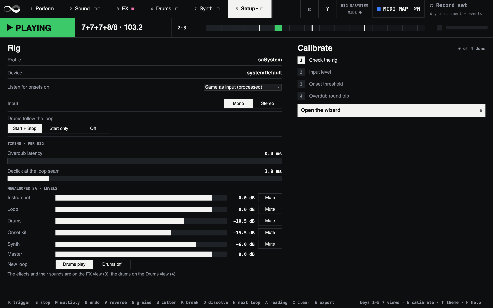

*Fig: Setup's Rig page on the saSystem rig: the audio, the analysis input, the timing values and Megalooper SA's levels, with Calibrate beside them.*

The controls, by view:

- **Audio** *(Setup › Rig)* — the input and output devices, the input your
  instrument and a bass are on, and the buffer, as in the launcher
  ([Configuration](#configuration)). A change wakes **Apply and restart**;
  click it twice and megalooper starts again on the new audio, because the
  device is fixed when the audio server starts. The loop goes, and the
  effects, drums and synth come back as kept (Keep on their views); while
  Record set runs it refuses, so the set's files end where you chose. A
  device that gave way at the start, or an input it does not have, is said
  in red under the menus. On a rig of yours the section shows its name and
  device instead: the profile says them.

- **Drums follow the loop** *(Setup › Rig)* — whether the drums start and stop
  with the loop:
  - *Start + Stop* (default): they start when the loop plays and stop when it
    stops.
  - *Start only*: they start with the loop and play on after a stop.
  - *Off*: they do not start with the loop; switch them on yourself.
- **Input** *(Setup › Rig)* — *Mono* or *Stereo*; the profile's
  `inChannelCount` sets it at boot (saSystem: Stereo). Stereo records both
  sides of the instrument chain, so its stereo effects reach the loop. Mono
  records one side and plays it on both ears. It takes effect on the next
  record or play.
- **Listen for onsets on** *(Setup › Rig)* — which input the onset and pitch detection listens
  to. *Clean tap* reads the instrument's **dry hardware input**, before the
  effects; *Same as input* analyses the processed instrument being recorded. Only the
  analysis moves — the loop is recorded from `inChannel` either way. Distortion
  and ambient FX smear note attacks, and blurred onsets are the main cause of
  meter mis-detection, so the dry tap is the better default where the rig
  exposes one. If a take reports 0 onsets while recording fine, the tap is on
  the wrong channel — the log says so. The recorder also compares the
  tap's peak with the recorded input's over every take and warns when the tap
  sits 30 dB or more below it: a tap that quiet still yields a few onsets at a
  low threshold, and the meter fitted to them is noise — fix the gain, not the
  threshold. See [docs/routing.md](routing.md).
- **Master** *(Perform's macros)* — the looper's own level: the loop, the
  cutter and the grains together, after their limiter (0–1, starts at 0.7).
  The whole mix's last fader is **Master** under Levels.
- **Morph** *(Perform's Grains column)* — between frozen drone (0) and pulsed scan
  locked to the detected pulse (1). Mirrors the Grains' Morph on Sound (CC 118 in the
  keys-and-knobs map); moving either updates both. Sound holds the rest of the layer.
- **Overdub latency** *(Setup › Rig)* — round-trip latency compensation (0–100 ms).
  See "Calibrating overdub latency" below.
- **Declick at the loop seam** *(Setup › Rig)* — the fade at the loop seam,
  0–20 ms, default 3. Higher hides clicks but softens the seam.
- **Feedback** *(Perform's Loop column)* — how much of the existing buffer content is preserved
  during overdub. `1.0` (default) is classic additive overdub: existing
  content stays at full level and the new input layers on top. `0.0` makes
  the overdub *replace* the existing content. Intermediate values fade the
  existing content by that amount per overdub pass (so e.g. `0.5` halves the
  existing audio each pass, useful for self-erasing layered patterns).
  Feedback only takes effect while overdubbing — pure playback always passes
  the buffer through untouched.

### The status band

The top of Perform (`scripts/gui-status.scd` builds and paints it) answers
"what is it doing right now" at a glance, and its strip keeps the answer on
every other view. It is **read-only** but for Revert — painted from model
notifications, so nothing here can be clicked into a state you didn't intend.

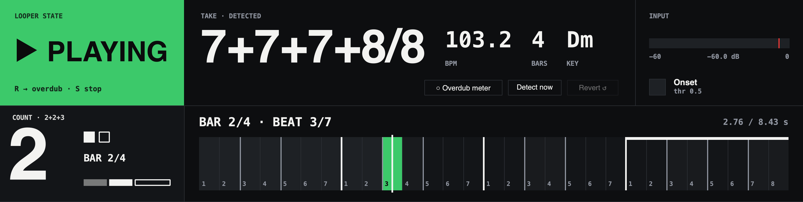

*Fig: The status band on Perform: the looper's state, the take as it was read (7+7+7+8/8 at 103.2 BPM, four bars, D minor), the input, the count (group 2 of the bar's 2+2+3) and the bar grid with the beat that is playing.*

- **Count** — the beat group the loop is in, big enough to read across the
  stage. The groups are the analyser's: 7/8 is 2+2+3, an 8/8 bar 2+2+2+2,
  12/8 four threes, 5/8 2+3; in 4/4 each beat is its own group, so the count
  is the beat. Beside the number, the group's beats as squares (filled up to
  the one playing), the bar, and the bar's groups as a strip. On uneven bars
  the odd one is flagged a bar ahead: all through the third bar of
  7+7+7+8, `8 NEXT` stands in the corner, and the caption says `THE 8` while
  it plays.

  **The count-in.** Before something that lands on the next loop boundary — a
  break's end, a reading, the next loop's recording (and its close), the
  cutter coming in — the caption says what and how many loops away
  (`BACK IN 1 LOOP`). In the last bar before it the block turns yellow and
  counts the groups left, `3 2 1` in 7/8 or `4 3 2 1` in an 8/8 bar, and the
  grid outlines that bar; on the boundary it shows the event's word (`BACK`,
  `NEW`, `REC`, `LOOP`, `CUT`) for one group. An event cancelled before its
  boundary says nothing.

  The count is drawn **on** the beat, not sampled: between the 20 Hz reads of
  the engine's phase bus the playhead is predicted from the last one, and the
  count's routine sleeps to the next beat line. The grid is painted from the
  same prediction, so the two never show different beats.

  **On a controller's buttons.** A controller that takes MIDI back, such as the
  Faderfox UC4, can show the count on its buttons' lights. There are three,
  each a control you map like any other:

  - **Beat light** flashes on each beat group's first beat, and longer on a
    bar's first;
  - **Count-in light** is lit through the last bar before an event the count
    counts in to, and goes out on the boundary;
  - **Odd bar light** is lit through the bar before the odd one of uneven bars.

  In MIDI Map mode, click the count and press a button to learn the beat
  light; the other two are under **Add a mapping › Perform › Count lights**.
  The controller needs **Send back** switched on (Setup's MIDI map section).
  A light's button drives nothing: pressing it only has its light put right.
  On the UC4, set the button's LED mode to **EXt** (in **Std** the UC4 lights
  the button while you hold it), and over DIN its routing to **Rou0** or
  **Rou4**, so it doesn't pass what it is sent back in. The lights are sent on
  their own clock, on the beat as you hear it, not on the send-back's 20 Hz.

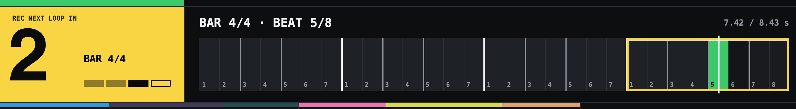

*Fig: The count-in: the next loop is armed and the playhead is in the last bar of 7+7+7+8, its third group. Two groups to go; the grid outlines the bar.*

- **Bar grid** — a cell per beat, bar lines in ink, a heavier line at each
  beat group's head with every other group faintly shaded, the odd bar of
  uneven bars marked along its top, the beats played this pass shaded and the
  beat under the playhead filled in the state's colour (the hatch on a break),
  with `BAR 2/2 · BEAT 3/7` and `3.42 / 7.00 s` over it. Read off the engine's
  own phase bus 20 times a second and predicted between the reads, so it
  cannot drift against the audio. With no meter detected it falls back to
  elapsed/total alone rather than inventing a beat. **Bar 1 beat 1 is where you pressed
  record** — the same downbeat the drums' step 1, the cutter's beat 0 and the
  break's resume use, so the four never disagree, even on a take that opens
  with a pickup. A meter detected from an overdub counts from the downbeat that
  detection chose, which is also where it started the drums.
- **Take** — what the analyser decided: `7/8`, `103.2` BPM, `2` bars, the key;
  `TAKE · ANCHORED` when the loop fell back to the length-anchored meter, which
  is also the reason the cutter will refuse to start. When the analyser's
  runner-up scored close the chip says so — `or 7/4 @ 206.4?` — which is the
  take that wants the next-reading switch; while a reading is armed the chip is
  filled and counts down, `→ 7/4 @ 206.4 BPM · 2 bars · lands in 1 loop`, and
  once one is in force it says which, `reading 2/5`. See
  [The next reading](#the-next-reading).
- **Input** — the level, off the analysis monitor's feed, in dB. The first
  answer to "is the instrument getting through at all", so it is never behind a
  view.
- **State** — the block: `EMPTY`, `● REC`, `▶ PLAYING`, `● OVERDUB` or
  `■ STOPPED`, filled so recording and overdub are unmistakable across a room,
  and the Break hatch while a break is open.

**MIDI in** (Setup › MIDI & AI) is a scrolling monitor of incoming note / CC / program
messages, the same lines the post window shows. **Pause** freezes it while you
read; **Clear** empties it. It keeps the last 200 lines and repaints at 10 Hz
while its page shows, so a CC sweep can't stall the GUI. `~midiLog` silences only
the **post window** — the monitor always receives, which is the point: you can
stop the post spam and still watch the controller. The top bar's lamp lights on
every message, whichever view shows.

### Onset analysis

`MeterAnalyzer` never hears audio — only onset times. So when detection admits
ghost onsets or misses real hits, meter detection fails and the loop drops to the
anchored fallback meter. That is the documented root cause of straight 4/4 takes
coming out 7/8, and the **onset threshold** is the lever. Tuning it is something
you do *while playing*, so the two controls that matter are on Perform — the
lamp in the status band, the threshold among the macros — and the rest is in
Setup's Analysis page (`scripts/gui-analysis.scd`).

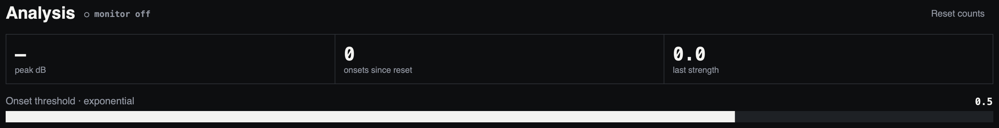

*Fig: The top of Setup's Analysis page: the input's peak, the onsets counted and the last one's strength, and the onset threshold.*

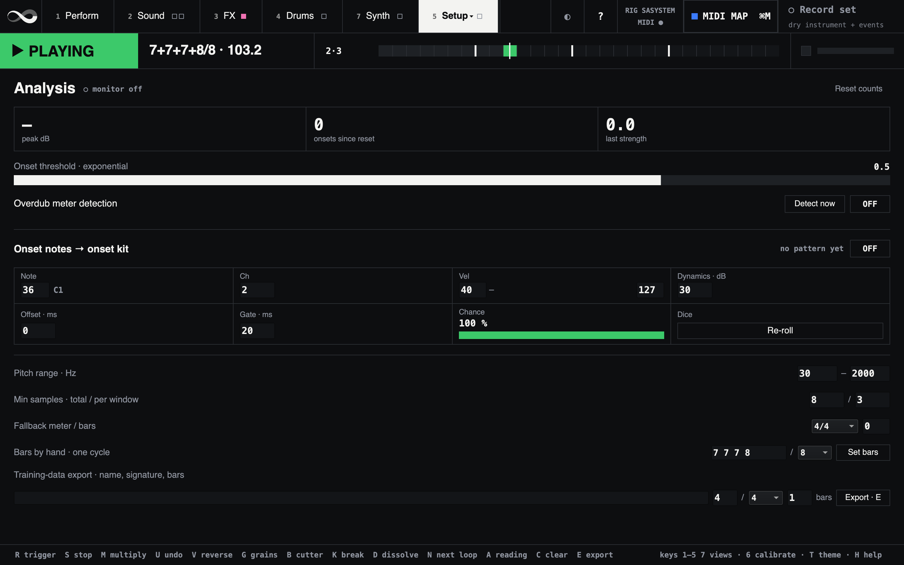

*Fig: Setup's Analysis page: the onset threshold, overdub detection, the onset notes, the pitch range, the fallback meter, Bars by hand and the export.*

On **Perform**:

- **Onset lamp** — a light that flashes for ~200 ms every time the detector
  fires at the current threshold. Flashes *between* notes mean ghosts (raise the
  threshold); a hit that leaves the lamp dark means it's too high. If it never
  flashes at all, check the input meter above it: a flat meter means the
  analysis input is silent (wrong channel), not that the threshold is wrong.
- **Onset** macro, the threshold (0.01–2.0, default **0.5**), also a MIDI target for a pedal —
  live on both the monitor *and* a running recorder, so you tune against what
  you're playing and the next take detects exactly what you just saw. The
  travel is **exponential**: a nudge of 1% of the slider moves the threshold by
  about 5% of wherever it currently is, so it feels the same at 0.05 as at 1.0.
  On the old linear slider every setting worth telling apart was crammed into
  the first tenth of the travel. The trade is a coarser top end, which is the
  end nobody tunes in; the default 0.5 sits at about three quarters across.

In **Setup's Analysis page**:

- **Monitor** toggle — a free-running detection chain that mirrors the recorder's
  exactly (same input, odf type, `mingap`, threshold). It needs no loop and no
  transport, so you can set the threshold *before* committing a take. It runs
  from the start on every view, because the status band's input meter and
  onset lamp read it: switch it off and both go dark.
- **Readout** — input peak in dB, onsets counted since the last reset, and the
  strength of the most recent onset (the same salience value `MeterAnalyzer`'s
  accent test sees). **Reset counts** starts the count again.
- **Onset notes** — plays the loop's onsets on the onset kit. See
  [Onset notes](#onset-notes) below.
- **Pitch range · Hz** — 30–2000: the band the pitch tracker believes.
- **Min samples · total / per window** — 8 / 3: how many pitch readings a
  take, and each chord window, needs before a key or a chord is named. From
  the next take.
- **Fallback meter / bars** — see [How meter detection
  works](#how-meter-detection-works).

The threshold belongs to the rig: Calibrate's threshold step keeps it for this
rig ([The calibrated values](routing.md#the-calibrated-values)). How noisy the
instrument input is depends on the interface and the tap.

If the clean tap hears a take 30 dB or more under the input, the log says the
analyser was starved: check the tap's gain or channel before lowering the
threshold.

`mingap` (20 frames, about 107 ms: the shortest gap between two onsets) is not
a control. `Onsets` sizes its state from it, so it cannot change on a running
synth. It is set in one place, `Looper.prOnsetTrig`, which every detector
shares.

> **Why a lamp and not a waveform.** This pane used to draw a scrolling envelope
> with the onsets marked on it. It was the most expensive thing in the GUI — 120
> `Pen` calls per repaint off a 60 Hz feed, measured wrecking the language's
> timing whenever the tab was on screen — and it answered only the one question the lamp answers
> directly. Plotting the *detection function* instead would have been worth the
> cost, but it isn't available: `Onsets` whitens its odf before comparing it to
> the threshold, so the UGen's `rawodf` output is on a different scale entirely
> (measured here: raw odf averaged ~1.4 while a threshold of 0.5 was firing only
> on real hits). Drawing that against the threshold would look informative and
> be wrong.
>
> The monitor synth reports on two clocks to make this cheap: the input level at
> **15 Hz** (enough for a meter) and each onset on its **own trigger**, one OSC
> message per hit. Sending onsets as a flag polled at the level rate is what used
> to force that rate up; on their own trigger they can't be missed by frame
> quantisation or merged when two land in one frame.

### Overdub meter detection

For loops that open atmospheric. Take one has no attacks, so no meter is found
and the drums never start — correct, there is no beat to follow. Turn on
**Overdub meter detection** on Setup's Analysis page, overdub a rhythmic
pattern, and the meter is derived from *that* instead, then the drums start.

- **Runs on `endOverdub`**, and only while the loop still has **no valid meter**
  (a length-anchored fallback counts as none). Without that gate every overdub
  would re-tempo the drums mid-performance.
- **Detect now** forces a re-analysis of the last overdub's onsets past that
  gate. The quality guards below still apply.
- Onsets arrive already in **loop coordinates**: the engine publishes its read
  position on a control bus and the analyser latches it at each onset, so
  several loop passes fold onto one grid with no clock arithmetic — and playing
  the pattern a few times *strengthens* the grid rather than flooding it. Hits
  within 30 ms of each other merge, keeping the loudest reading.
- The loop is **never resized**; there is already audio in it. Instead the tempo
  is forced to divide the existing loop exactly (`tau = loopDur / n`). A tempo a
  hair off the loop length drifts against the drums over a few minutes.
- **The drums start on the detected downbeat**, not immediately — the start is
  held until the loop next reaches that phase, so their first step lands on the
  music rather than wherever the analysis happened to finish.

Three guards, fixed in `Looper.sc`, make this safe, and they exist because
widening the search breaks things in both directions:

| Value | Default | Why |
| --- | --- | --- |
| `overdubMaxBars` | 8 | The default 4-bar enumeration cannot describe a long pad. Measured: a 12 s loop at 120 BPM in 4/4 (**six** bars) is reported as *12/8 at 60 BPM* — confidently wrong — until the limit is raised. First-take detection keeps the tighter default. |
| `overdubMinDensity` | 0.5 | A fine grid will always "fit" a few scattered onsets. At no density, five rubato onsets came out as *7/4*. Measured on synthetic patterns: 0.5 admits real playing and rejects rubato; 0.6 starts rejecting genuine syncopation. |
| `overdubMinOnsets` | 8 | An absolute floor before detection is even attempted. |

Both thresholds are **provisional** — tuned against synthetic onset patterns, not
real playing, exactly like the onset threshold itself.

### The next reading

The analyser scores every meter that fits a take and keeps the ranked list, not
only the winner. On realistic takes the winner is right about half the time,
and when it is wrong the runner-up is the truth in a third of the cases. So the recovery for a
wrong meter is one footswitch: **key `A`, the Next reading tile on Perform, or a
switch mapped to it** moves the take to the reading
that scored second. Press it again and it moves on to the third; past the last
it comes round to the analyser's own answer, so one switch always gets you
back. **Revert**, beside the reading chip, goes straight home.

What it changes and what it leaves alone:

- The **audio never changes**, and neither does the onset-note drum part —
  those are the hits you played, and they never looked at the meter.
- The **cutter** follows the new grid. A reading that keeps the pulse and the
  pulse count (7/8 read as 7/4, or two bars of 6/8 read as one of 12/8) leaves
  it running untouched; one that changes the pulse (12/8 read as 4/4) respawns
  it on the boundary, with no hole in front of it.
- The **grains** take the new pulse at once; the **dissolve** counts the new
  bar from its next arming; the **status band** shows the new take.
- The **drums** take the new tempo and meter the way an analysis delivers them.

**It lands on a loop boundary, never on the press**, and the reading chip counts
down to it, so the bass player hears it coming the way a break is heard. Which
boundary: a reading that changes how many quarter notes a loop holds makes the
drums' bar line meet the loop boundary only every so many loops, so the looper
takes the next boundary or the one after, whichever the drums' bar line falls
on; when neither does, it lands on the next one and the drums start again from
it.

Refused, with a line in the log and nothing lit: when nothing is playing, on a
take that fit no grid, because the length-anchored fallback has no next
reading to offer, and on a take that only one reading fit. A stop, a clear, a new take or an undo cancels a
reading that has not landed.

## Onset notes

The onsets `MeterAnalyzer` fits its grid to are also, straightforwardly, a drum
part — they are exactly where the attacks were. Turn on **Onset notes** on
Setup's Analysis page and they play the **onset kit** (its kit is chosen on the
Drums view), once per loop pass: a drum part from the rhythm you played.

### It replays the loop, it does not track your hands

This is a **stored pattern**, built once when a take is analysed and then
repeated in lockstep with the audio — not a live trigger off the detector. That
is the more useful of the two for a looper:

- It keeps playing when you stop playing, which a live trigger cannot.
- It repeats *exactly*, so what plays on pass 40 is what played on pass 1.
- It carries none of the detector's ~15–25 ms latency: the pattern is scheduled
  against `loopStartTime`, the wall-clock moment the loop's audio actually leaves
  the server, so each hit sounds as its own audio is heard.

The pattern comes from the same onsets the meter was fitted to. For a loop whose
**first take had no attacks at all**, it comes instead from the overdub that gave
it its meter — so turning on [Overdub meter detection](#overdub-meter-detection)
also gets an atmospheric loop a drum part.

### Controls

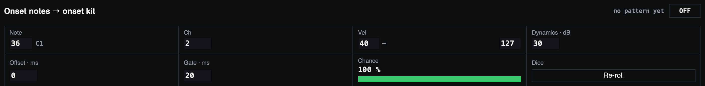

*Fig: Onset notes on Setup's Analysis page, with the settings the table below lists.*

| Control | Default | What it does |
| --- | --- | --- |
| **Onset notes** | off | Toggle. Starts and stops with the loop. |
| **Note** | 36 (C1) | The onset kit's pad every onset plays: 36 is its first pad, the kick in the shipped kit. Octaves are numbered with middle C as C3, so 36 is C1, not SC's C2. |
| **Ch** | 2 | The notes' MIDI channel, 1–16. The onset kit plays them whatever it is. |
| **Vel** | 40–127 | Velocity of the quietest and loudest hit. |
| **Dynamics** | 30 dB | How far below the loop's loudest hit maps to the minimum velocity. Small = compressed, large = wide. |
| **Offset** | 0 ms | Timing trim, **negative sends the notes earlier**. Per-rig — see below. Takes effect on the next hit, so dial it while the loop runs. |
| **Gate** | 20 ms | How long each note is held, as the notes are written into the set's `-drums.mid`. The onset kit's pads play each hit out whatever it is. Shortened automatically so a gate can never run into the next hit. |
| **Chance** | 100% | How likely each onset is to be sent. See [Thinning the part](#thinning-the-part) below. |

The readout beside the toggle shows how many hits are in the pattern and how long
one pass of it is — and, once Chance is below 100%, how many of them are actually
playing.

### Thinning the part

What you play is usually busier than the drum part you want out of it. **Chance**
is the slider for that: at 100% every onset is sent, at 50% about half of them,
at 0% none. Nothing is edited — the analysed pattern is left whole, so sweeping
back up to 100% returns exactly what you played.

The dice are thrown **once per take**, not once per pass. That matters, and it is
the one thing to understand about this control:

- The thinned part still **repeats exactly**, pass after pass, like the full one
  does. That is the property the whole feature rests on, and a per-pass re-roll
  would have thrown it away for a drum part that changed every time round.
- The slider is therefore **monotonic**: 50% → 60% *adds* hits, it does not
  reshuffle the ones already sounding. You can dial it against the loop and hear
  the part fill in rather than scramble.
- To get a *different* subset at the same density, press **Re-roll**. It touches
  nothing but which hits sound — same pattern, same timing, same audio.

A new take rolls fresh dice, and undo restores the take's own roll along with its
audio, so an undone loop comes back with the part you were hearing.

Chance is read per hit as the note is sent, so moving the slider or re-rolling
lands on the next hit — no rebuild, no restart, and the pattern never loses phase
against the audio.

### Velocity

Velocity is mapped from each onset's strength — the same salience value the
accent analysis uses — **relative to the loudest hit in that loop**, over the
Dynamics window in dB. Two consequences worth knowing:

- It is **gain-independent**. Moving the interface's input trim does not change
  the velocities, because nothing here is an absolute amplitude.
- It is **dB, not linear**. Linear on amplitude piles nearly every onset
  into the top of the velocity range; in dB the dynamics read the way they
  sounded.

The velocity controls are evaluated per note as it is sent, so changing any of
them takes effect on the very next hit — no rebuild, no restart, no gap.

### Lining the notes up

The loop's audio and the onset kit's hits leave through different strips of the
mixer, and both are scheduled from the same origin — `loopStartTime`, the
wall-clock moment the loop's audio starts — so what is left is a small, fixed
per-rig difference. That is what **Offset** is for. It belongs to the rig: set
it by ear, then write it into your profile as `onsetNoteOffsetMs` ([The
calibrated values](routing.md#the-calibrated-values)).

Guessing at it by ear is hard, because a 10–20 ms flam is easier to hear than to
size. To **measure** it instead, record the set: the loop and the onset kit are
stems of their own.

1. Play a loop with the onset notes on, press **Record set**, and record a few
   passes.
2. Open `-loop.wav` and `-onset.wav` side by side, zoom in on a hit that
   appears in both, and measure the distance between the two transients.
3. If the drum hit is **later** than the loop transient by *n* ms, set Offset to
   **−*n***. Record again and confirm it closed.

### Across multiply, undo and loop chaining

The pattern keeps **its own period** — the loop length it was built for — rather
than following `loopFrames`. Multiply and loop chaining both lengthen the loop
by a whole-number factor and copy the audio with it, so a pattern at the
original period tiles across the longer loop exactly as the audio does. Undo
snapshots and restores the pattern with the buffer, so undoing a take does not
leave the previous take's rhythm playing over it.

Two things follow from the pattern being tied to an analysis:

- A **loop chained** over another inherits the old pattern, because chaining
  records without analysing. The captured audio contains the old loop, so the
  rhythm is still in there, but it describes the take underneath, not what you
  just played over it.
- The **onset threshold is the ceiling on quality**. Ghost onsets become ghost
  notes and missed hits become missing ones, so this is one more reason to tune
  the threshold against the onset lamp in the status band.

## Granular layer

Press `G` to toggle a parallel granular voice using SuperCollider's `Warp1`
UGen, sourced from the recorded loop region.

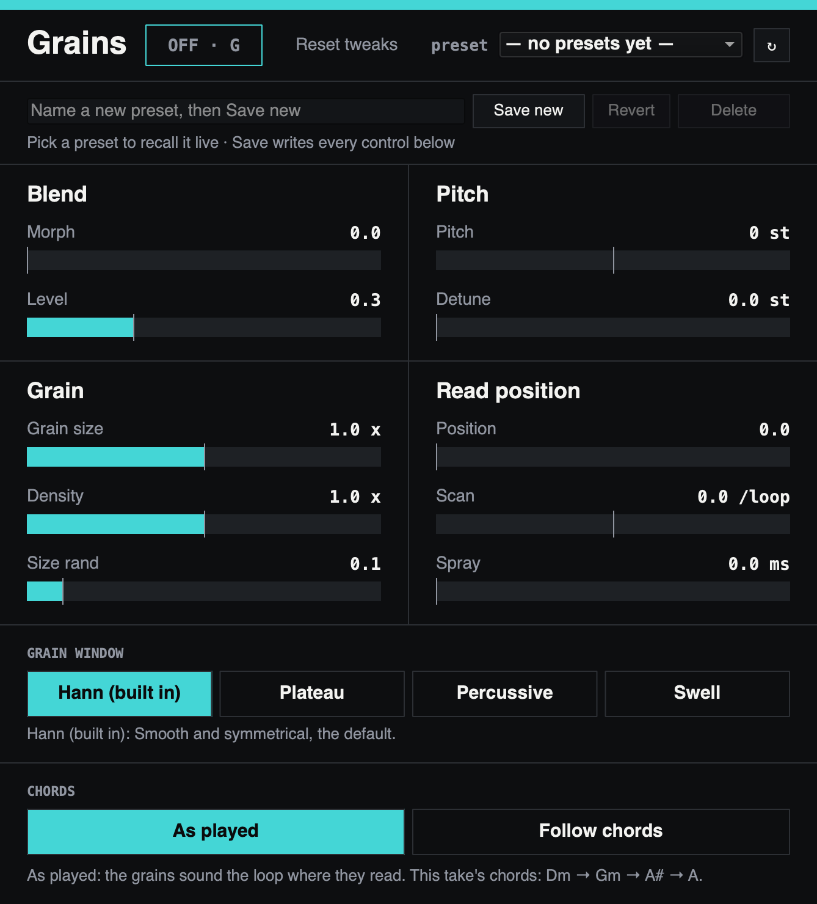

*Fig: The Grains, on the right of the Sound view (2): their four sections, and the grain window under them.*

### Morph: the meta-control

One parameter, **Morph** (Perform's Grains column and the Grains' Blend
section; CC 118 in keys-and-knobs), slides between two poles:

- **Morph = 0** — Frozen drone: long (~0.4 s) grains, heavily overlapped, with
  a static pointer plus tiny jitter. A smear of one moment in the loop.
- **Morph = 1** — Pulsed scan: grain window equals the detected `tau` (one
  beat), no overlap, pointer scans through the loop region in one full pass
  per `loopDur`. Grain N reads from beat N of the recording, so the rhythm of
  the granulator matches the rhythm of what was played. The scan is read off
  the dry engine's own playhead, so it is locked to the loop by construction:
  toggle the layer on wherever you like, mid-pass or not, and the pulse lands
  on the loop's own hits every time. Over a stopped
  loop there is no playhead to follow and the scan runs free until play starts.

Everything in between is a continuous lerp of the four underlying parameters
(window size, overlaps, scan rate, jitter). A 100 ms lag smooths the CC stream.

### The Grains pane

Morph is a great *performance* control and a poor *sound-design* one: it moves
four things at once and there is no way to ask it for "the pulsed grid, but an
octave down and sprayed loose". So the Grains, on the Sound view
(`scripts/gui-granular.scd`; key 2, or the Grains column's name on Perform), expose
the rest of the granulator, and morph keeps its job — it sets the **base** of the
texture, and every control here **bends that base**.

**ON · G** toggles the layer like `G`; it is refused while no loop is
recorded. The controls are in four sections, **Blend**, **Pitch**, **Grain**
and **Read position**, with **GRAIN WINDOW** under them.

Every default is **neutral**: with all of them untouched the layer sounds exactly
as it did when morph was the only control. **Reset tweaks** puts them all back
without disturbing morph itself.

| Control | Range | What it does |
| --- | --- | --- |
| **Level** | 0–1 (0.7) | Granular level, summed with the engine before the master limiter. |
| **Pitch** | ±24 st | Grain transposition. The read pointer is untouched, so this pitches the layer *without* changing how fast it moves through the loop. |
| **Detune** | 0–12 st | Random detune redrawn for **every grain**. Under ~0.2 st it thickens like a chorus; a few semitones shatters the loop into pitched confetti. |
| **Grain size** | ⅛–8 × | Grain length as a multiple of morph's (0.4 s drone, one beat pulsed). Below ~0.2× grains stop carrying pitch and read as texture. |
| **Density** | ¼–4 × | Overlapping grain count, as a multiple of morph's (6 drone, 1 pulsed). Thickness — and the CPU bill. |
| **Size rand** | 0–1 (0.1) | `Warp1`'s `windowRandRatio`: how much grain *length* varies grain to grain. A little breaks up the comb filtering perfectly regular overlaps produce. |
| **Window** | 4 shapes | Grain envelope: **Hann** (Warp1's own), **Plateau** (flat top — thicker drones, harder pulses), **Percussive** (instant attack, long decay — this is what makes the pulsed end read as *rhythm*), **Swell** (attacks erased; even a plucked loop smears into pad). |
| **Position** | 0–1 | Where in the loop grains read from. At the drone end this **is** the freeze point — sweep it to walk the drone through the recording by hand. Wraps, so it can never read past the loop's end. |
| **Scan** | ±2 /loop | **Extra** passes through the loop per loop duration, added to morph's own. Small values drift a frozen drone; negative runs the read head backwards; −1 exactly freezes a fully pulsed scan. |
| **Spray** | 0–500 ms | Per-grain read-position randomness. Unlike morph's own jitter this survives at the pulsed end — it is how you loosen a locked grid without giving up the beat. |

### Grains presets

The preset bar at the top of the Grains stores the whole voice — morph plus
every control below it — under a name, in `granular/` in your megalooper
folder. The bar works like the Cutter's (see [The Cutter's presets](#presets)).
What differs:

- Recall **includes morph**, unlike **Reset tweaks**, which leaves it alone: a
  preset is "this exact sound", where Reset is "undo my edits". A running
  layer follows a recall without stopping; with the layer off it just loads
  the settings for the next `G`.
- The **window shape is stored by name**, not by index, so adding a shape in a
  later version cannot re-point presets saved before it. An unknown shape falls
  back to Hann.

Every control here can be on a knob (keys-and-knobs uses CC 118, 119 and
40–47). A recall moves the values, not the knobs: with **Send back** on, a
controller that takes MIDI back follows; otherwise the knob's takeover decides
what happens when you next touch it.

### How the controls combine

Two conventions are worth knowing, because they are why the controls behave the
way they do:

- **Multiplicative where morph's base is never zero** (size, density),
  **additive where it is zero at one pole** (scan, spray). A multiplier on scan
  would be dead exactly where you want it: no amount of scaling gets a frozen
  drone to drift.
- The two multipliers have **geometric ranges centred on 1×** (⅛–8, ¼–4), so the
  middle of the slider — and CC 64 — is neutral. An off-centre neutral makes a
  multiplier impossible to return to by feel.

Density is clipped at **16 overlaps** in the SynthDef. `Warp1` runs one grain
stream per overlap and this is the parameter that runs the server up; 16 is
already past musically useful, and the clip keeps a full-tilt slider from
stalling the audio thread mid-take.

Grain interpolation is **cubic** (`Warp1`'s `interp: 4`). It was `1` (none),
which was fine while the layer only ever played at unity rate; with
transposition exposed, no interpolation aliases audibly.

The pane is a view like any other: sliders write to the model only, and the
`SimpleController` in `gui-wiring.scd` writes back. That is what keeps a MIDI CC,
the Reset button and the slider itself all showing the same number — including
while the Sound view is hidden, because panes are built once and kept alive
rather than rebuilt on every view switch. Rebuild it alone with
`~buildGranularPane.()` followed by `~wireLooperController.()`; the loop and a
running granular layer are both untouched.

## BBCut layer

Press `B`, or the **ON · B** switch on the Cutter or Perform's Cutter column,
to re-splice the loop in tempo, using
[Nick Collins's BBCut library](https://github.com/nhthn/BBCut). The cutter
needs an analysed take; without one it stays off and the footer says why.
**Mix / Insert / Gate** sets how it sits against the dry loop. **Mix** plays
the dry loop with the repeats on top. **Insert** (the default) ducks the dry
loop only while a repeat plays. **Gate** mutes the dry loop, so you hear the
cutter alone.

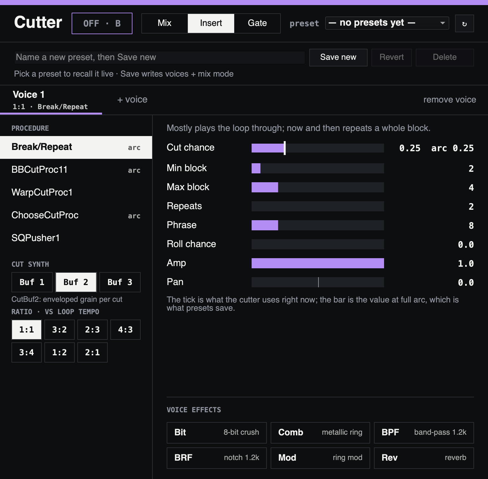

*Fig: The Cutter, on the left of the Sound view (2): its voice, the voice's procedure and parameters, its cut synth, ratio and voice effects.*

The cutter is a **multi-voice instrument**: each voice is an independent cutter
(its own procedure, cut synth, effects, and clock) layered over one shared
snapshot of the loop. Everything is on the Cutter, the left half of the Sound
view (key 2): a tab per voice, **+ voice** (four at most) and **remove voice**.

- **Polyrhythm** — each voice runs on its own clock at `baseBps × ratio`, where
  `baseBps = 1 / tau` (one tick per detected pulse) and `ratio` is chosen per
  voice (`1:1`, `3:2`, `2:3`, `4:3`, `3:4`, `1:2`, `2:1`). All voices are
  phase-aligned to the same loop downbeat at start, so non-unity ratios produce
  true cross-rhythm.
- **Cut procedure** (per voice) — choose from a curated set: **Break/Repeat**
  (the default, see below), **BBCutProc11** (d&b-derived 3+3+2
  splicing), **WarpCutProc1** (Warp-Records pitched rolls), **ChooseCutProc**
  (cut/repeat/roll chooser), **SQPusher1** (Squarepusher-style drum
  programming). The procedure's own parameters are shown as bars. Most
  parameters change at the next phrase or block. WarpCutProc1's **Accel** and
  all of SQPusher1's are read when the voice is built, so changing one rebuilds
  the voice when you let go of the bar. Hover a parameter for its range and
  default.
- **Arc** — a procedure tagged **arc** has one parameter the pedal drives (see
  [The arc](#the-arc--intensity-and-dissolve)). Its bar is the value at full
  arc, which is what presets save, and the tick is what is in use now.
- **Cut synth** (per voice) — **Buf 1** (CutBuf1, the cheapest; it may click),
  **Buf 2** (CutBuf2, an enveloped grain per cut; the default), **Buf 3**
  (CutBuf3, keeps the original pitch at any tempo).
- **Effects** (per voice) — toggle any of **Bit** (decimator), **Comb**, **BPF**,
  **BRF**, **Mod** (ring mod), **Rev** (reverb); inserted between the cut synth
  and the voice mixer.
- **Amp / Pan** (per voice) — live via the voice's `CutMixer` (no rebuild).
- The cut buffer's `beatlength` is the number of pulses in the loop, every
  bar's length added up: 7 for one bar of 7/8, 29 for 7+7+7+8.
- **Phrase** is in **beats** on every procedure that has one (SQPusher1 has
  none), as an integer-stepped bar. Break/Repeat and BBCutProc11 also *snap*
  it to a whole number of loop passes, because both read repeats at
  `phrasepos % beatlength` while `phrasepos` resets to zero each phrase — a
  partial pass would restart the cutter's read head mid-loop and pull it out of
  alignment with the dry loop. Warp and Choose take the beat count literally;
  they cut continuously rather than tracking the dry loop, so nothing depends
  on the alignment.
- Phase-aligned: the cutter starts on the next loop downbeat.
- Snapshot semantics: switching the cutter on captures the current loop region
  to a temp WAV (`megalooper_bbcut.wav`). Later overdubs, multiplies and undos
  do **not** refresh the snapshot — switch it off and on again to pick up new
  audio. Structural changes (procedure, synth, effects, ratio, adding or
  removing a voice) while the cutter is on rebuild it in place.
- Recording a new loop, stopping or clearing switches the cutter off. A next
  reading that changes the pulse rebuilds it on the new grid, from a fresh
  snapshot.
- Each voice runs on its own clock at the analysed tempo and is not corrected
  afterwards. Over a long loop it can drift a little against the loop and the
  drums, which follow the loop itself. Switch the cutter off and on to line it
  up again.

### Break/Repeat — the cut procedure for played loops

The classic BBCut procedures chop continuously, which suits a drum break but
buries a played loop. `LooperBreakProc` (menu name **Break/Repeat**,
the default for a new voice) inverts that: it mostly lets the loop through
untouched and only now and then grabs a block and repeats it, like stepping on
a beat-repeat pedal for a bar.

| Control | Range (default) | What it does |
| --- | --- | --- |
| **Cut chance** | 0–1 (0.25) | Probability, rolled once per block, that a repeat happens at all. 0 leaves the loop completely alone; 0.25 gives an occasional interruption; 1 repeats continuously. The arc drives it. |
| **Min block** / **Max block** | 1–16 (2) / 1–16 (4) | Size of the repeated chunk, in pulses (loop beats). Set them equal for a fixed size, spread them for variety. This is what makes big repeats possible — a whole bar rather than a stutter. |
| **Repeats** | 2–8 (2) | How many times the chunk plays. 2 = it plays, then repeats once. |
| **Phrase** | 2–32 (8) | Phrase length in beats, rounded to a whole number of loop passes. Raise it when a long block will not fit inside one pass of the loop. |
| **Roll chance** | 0–1 (0) | Probability that a repeat comes out as a double-speed roll instead of a plain repeat. Leave at 0 for straight beat-repeat behaviour. |

How it interacts with the mix mode: a block that is *not* cut is emitted as a
single cut, which the mixer and the insert gate both read as "no repetition".
So in **Mix** and **Insert** the cutter stays silent between breaks and you hear
your dry loop; in **Gate** the cutter plays the straight blocks itself, so the
loop is continuous either way.

Repeats replay the audio at the block's own position in the loop, and the
phrase is pinned to a whole number of loop passes, so the cutter stays lined up
with the dry loop before and after a break. A repeat that would overrun the
phrase end is fitted in by dropping repeats first and only then trimming the
chunk (possibly below **Min block**) — without that, on a short loop most
breaks would silently vanish and Cut chance would read far lower than it is set.

Every parameter is live: changes take effect at the next block with no rebuild.

### The other procedures

| Procedure | Control | Range (default) | What it does |
| --- | --- | --- | --- |
| BBCutProc11 | **Chop** | 2–32 (8) | Slices per loop pass: the cut grid. Higher is finer, busier chopping. |
| | **Phrase** | 2–32 (24) | Phrase length in beats, rounded to whole loop passes; a new cut pattern each phrase. |
| | **Stutter** | 0–1 (0.2) | Chance that a phrase ends in a stutter, a repeating one-slice roll. The arc drives it. |
| | **StutSpd** | 1–8 (2) | Stutter speed as a multiple of the chop grid. |
| WarpCutProc1 | **Phrase** | 2–32 (12) | Phrase length in beats before the next set of blocks is chosen. |
| | **Accel** | 0.5–1.5 (0.9) | Roll shape: under 1 accelerates, over 1 decelerates. Rebuilds the voice. |
| ChooseCutProc | **Phrase** | 2–32 (16) | Phrase length in beats before new cut sizes are chosen. |
| | **RollPr** | 0–1 (0.1) | Chance of a roll near the end of each phrase. The arc drives it. |
| | **RollLen** | 0.5–8 (2) | How many beats before the phrase end a roll may start. |
| SQPusher1 | **Activity** | 0–1 (0.1) | Chance of 16th- rather than 8th-note activity in normal bars. Rebuilds the voice. |
| | **FillFreq** | 1–16 (4) | A fill bar every this many bars. Rebuilds the voice. |
| | **FillScr** | 0–1 (0) | Chance that a fill is scrambled rather than played as stored. Rebuilds the voice. |

### Presets

The preset bar at the top of the Cutter stores a whole cutter setup — every
voice (procedure, cut synth, effects, ratio, amp, pan and all procedure
parameters) plus the Mix/Insert/Gate mode — under a name. Two cutter presets
ship with megalooper and are copied into your folder on the first start.

- **Save** writes `bbcut/<name>.scd` in your megalooper folder ([Where your
  files are](../README.md#where-your-files-are)). The name is slugged, so
  "Broken 3/2" becomes `broken-3-2.scd`. The button says what one click will
  do: **Save new** for a new name, **Save** for the preset you loaded, and
  **Overwrite** for another one, which then reads **Overwrite?** and writes on
  the second click.
- **Recall** is a single click in the preset menu, and applies **live**: voices
  are added/removed to match and each is rebuilt on the next beat. The dry loop
  keeps playing, the cut buffer is not re-written, and nothing is torn down.
  Recalling with the cutter off just loads the settings.
- **Revert** re-reads the selected preset from disk, discarding edits since it
  was loaded. **Delete** arms for 4 s and removes the file on the second click;
  it leaves the running cutter alone. **↻** rescans the folder for files added
  outside megalooper.
- Preset files are plain SuperCollider literals, safe to hand-edit or commit.
  Unknown procedures/synths/effects, out-of-range numbers, parameters left over
  from another procedure and missing parameters are all corrected on load, with
  one summary warning in the log; only a file that isn't a preset at all
  is refused, and then the running cutter is untouched. A file saved by a newer
  version of megalooper is refused rather than half-understood.
- A hand-edited `ratio` that isn't in the menu's list still plays as written; the
  menu just shows the nearest entry.

The cutter needs BBCut. The installer fetches it (see
[Install](../README.md#install)).

## Recording the set

**Record set** in the top bar, or a switch mapped to it, writes the whole set
into `sessions/`: what the room heard, each part of the mix on its own, every
drum hit as MIDI, your instrument dry, and a log of what happened, which is what
turns the recordings into something that can be analysed afterwards.


*Fig: Record set, at the top right of every view, and under it what the set will write.*

| File | What it is |
| --- | --- |
| `<stamp>-<tempo>-<meter>-master.wav` | what the room heard — stereo, the mix as it leaves for the interface |
| `-guitar`, `-loop`, `-drums`, `-onset`, `-synth.wav` (and `-bass.wav` on a rig with a bass) | the parts of the mix as heard: your instrument, the loop, the drums, the onset kit and the synth, after their faders, so they sum to the master |
| `<stamp>-<tempo>-<meter>-drums.mid` | every drum hit, steps and onset kit, to play other sounds with afterwards |
| `<stamp>-<tempo>-<meter>-tap.wav` | the dry instrument, mono, straight off the analysis tap |
| `<stamp>-<tempo>-<meter>-events.jsonl` | what happened: every record press, every take with the onsets it was analysed from and the readings it was offered, every next-reading press and where it landed, every threshold change, every transport action (play, stop, overdub, multiply, undo, clear), and every drum hit that sounded — one JSON object per line, times in seconds from the stomp |

**The names carry the tempo and the meter**: `261007_143012-165.04bpm-7-8-master.wav`
is the set stomped at 14:30:12 on 7 Oct 2026, at 165.04 BPM in 7/8, ready to
drop into a DAW at that tempo. The tempo and the signature are the first in
force while the set was recorded (the loop playing when it began, or the first
take, overdub detection or reading that applied). They are not known until the
set has a loop, so the files are written under the stamp alone and renamed when
the set stops. A set that never had a tempo keeps `<stamp>-master.wav`.

It has **no relationship to the loop's start**, which is the whole point: it is
already running while you play the take that *produces* the first loop. Every
file of a set starts from the same server block, so they line up against each
other to the sample. The master and the tap are int24 WAV; the parts are 32-bit
float.

The dry tap is not there to listen to. It is there so onset detection can be
re-run offline at any threshold — every gig becomes labelled corpus, which is
the largest lever on meter detection that does not involve touching
`MeterAnalyzer`. The event log is what makes that possible: without it the tap
is audio nobody can place a take in, which is what the sets recorded before it
existed turned out to be. See [Replaying a set](#replaying-a-set).

### Replaying a set

`scripts/replay-session.scd` reads a set's event log, cuts every take out of the
dry tap at the press, renders it through the recorder's own onset chain in
scsynth non-realtime at a sweep of thresholds, runs each onset list through
`MeterAnalyzer` and the Looper's own snapping, and reports which thresholds
would have agreed with you. No audio device is touched, so it can run beside
the playing instrument.

```
sclang scripts/replay-session.scd                # the newest set
~replaySession = "260928_183000";                # one set, by stamp, whatever tempo it was renamed with
~replayThresholds = [0.3, 0.5, 0.7];             # the sweep (default 0.2 0.3 0.4 0.5 0.6 0.8 1.0); the stage threshold is always added
~replayCsv = "/tmp/replay.csv";                  # every cell, for a spreadsheet
~replaySelfTest = true;                          # a synthetic set, rendered and asserted
```

The labels come from the [next reading](#the-next-reading) switch, and cost
nothing to collect:

| A take you… | is | and its label is |
| --- | --- | --- |
| played on as heard | **accepted** | the analyser's reading — a weak label: right, or wrong and not noticed |
| moved with the switch | **corrected** | the reading it settled on; the analyser was wrong on this take |
| gave bars by hand | **corrected** | the bars you gave |
| moved and moved back | **reverted** | none; the analyser was wrong and the truth was not on its list |
| undid | **discarded** | none |

Per take the report shows what was heard on stage, what you settled on, and the
reading at every threshold; the summary counts, per threshold, how many
corrected takes come out right and how many accepted ones still agree, and
names the takes that come out wrong at every threshold — those are the
analyser's limit, not the threshold's. A reading with the same tempo and loop
under another barring, 2/4 in two bars against 4/4 in one, is shown as ≈ rather
than counted wrong: the drums get the same BPM and the loop the same pulse, only
the bar line differs. It also checks itself: at the threshold
that was in force on stage the replay should reproduce the stage reading, and
the fidelity line says on how many takes it did. First takes only for now; an
overdub detection folds its onsets onto the loop's phase, which the replay does
not reproduce, so those are listed and not scored.

Every take also gets a `logged` row: the onsets the stage heard, run through
today's analyser. A reading that moved there moved because the analyser
changed, not the threshold. A take whose tap peak sat 30 dB or more under the
recorded input is marked **STARVED** and counted in the summary — the recorder
warns about the same take live, and the threshold table means little for it.

Under the sweep each take also gets rows that settle the threshold *after* the
take rather than before the set, which the instrument could do on stage since
the analyser only runs once the take is over. None of them changes what the
instrument does yet; they show whether it should:

| Row | reads |
| --- | --- |
| `auto` | the threshold whose reading the analyser scores highest (a reading that fit no grid is never picked) |
| `vote` | the reading most thresholds of the sweep agree on |
| `peak.15`, `peak.25` | the most liberal threshold's onsets without each one a hit within 0.15 / 0.25 s is clearly louder than (`~replayPeakRatio`, 1.4×): the accents, relative to the take, blind to the tap's level |
| `gap.15`, `gap.2` | the same onsets with nothing for 0.15 / 0.2 s after each kept one: a "so many notes a second at most" rule, which keeps the first hit of a cluster however soft |

The summary scores these rows like the thresholds and adds a grid of each
labelled take against the sweep. A column right all the way down is a
threshold to keep; rightness that wanders from column to column per take is a
threshold to choose per take. `~replayPeakWindows`, `~replayPeakRatio` and
`~replayGaps` set the filters.

A set started over a playing loop still yields that loop. The log's header
carries the take it came from — the raw length, the onsets from the press, the
analyser's answer and its list, the reading in force — and the report lists it
as *loop in force when the set began*: no audio to re-detect, but the stage
onsets go through today's analyser and the readings pressed during the set
label it like any other. Still, press **Record set before the first take**
whenever you can; only then is the take itself in the tap.

A tap recorded before the log existed can still be replayed with the takes
placed by hand — `~replayTap = "…-tap.wav"; ~replayManual = [[startSec, durSec], …]`
— but with nothing to score against; the report then shows readings only.

## Calibrating the rig — the wizard

Once per rig, open **Calibrate**: key **6**, or **Open the wizard** under
Calibrate on Setup's Rig page. **Esc** goes back. The left column lists the
four steps and which are answered. The middle says why the step exists, what
has to be true in the room, and what to do. The right column shows this rig's
**Onset threshold** and **Overdub latency**.

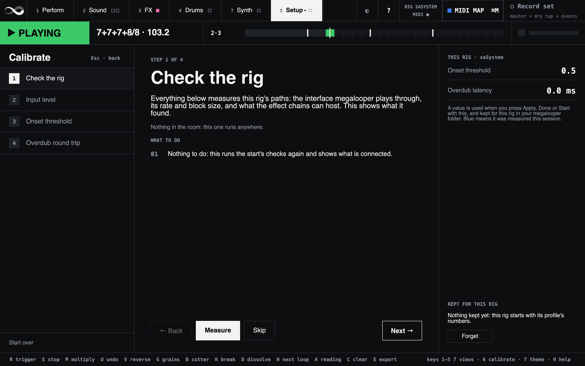

*Fig: The Calibrate wizard (6) at its first step: the four steps on the left, what to do in the middle, this rig's values on the right.*

1. **Check the rig.** Nothing to do: it runs the start's checks again and
   shows the interface, its rate and block size, and whether VSTPlugin is
   there.
2. **Input level.** Press **Measure** and play hard for eight seconds. Turn
   the interface's input gain until the loudest hit comes in between -12 and
   -3 dBFS. Too quiet and soft notes go unnoticed; clipped and every hit looks
   the same.
3. **Onset threshold.** Set it on Setup's Analysis page while you play: raise
   it until the lamp lights only on real hits, lower it until none are
   missing. Then press **Done**.
4. **Overdub round trip.** Stop the loop. With an interface, patch a cable
   from output 1 into the instrument input; on a computer's own speakers and
   microphone there is nothing to patch. Press **Measure**, then **Apply**. If
   it cannot be measured, set **Overdub latency** by ear on Setup's Rig page
   and press **Start with this**.

**← Back**, **Skip**, **Next →** and **Start over** move through the steps.

Things worth knowing before you run it:

- **The round trip is everything between the loop leaving megalooper and your
  instrument coming back into it**: the interface both ways, and the instrument
  chain's effects and plugin. Measure it with the chain as you will play it.
- **The cable** stands in for "you hear the loop and play in response", which
  is the only part of the round trip with no delay of its own. The instrument's
  strip is muted while it measures, so the cable is no feedback loop. On a
  computer's own speakers and microphone there is nothing to patch: turn the
  volume up and keep the room quiet.
- **Measuring and applying are separate buttons on purpose.** A measurement you
  can see but have not applied is how you notice one that is obviously wrong.

The round trip is measured eight times, and the wizard reports the **spread**
across the trials as well as the number. That is the diagnostic that matters:
one reading always produces a number, but eight that disagree is a clock
problem — an aggregate's clock source, drift correction, or a member at the
wrong sample rate — and the wizard says so rather than averaging it into a
plausible-looking latency. A click too weak to trust is refused as well.

A value is kept for the rig when you press **Apply**, **Done** or **Start with
this**. It goes into `calibration.json` in your megalooper folder, and every
start begins with it. **Forget** goes back to the rig's own numbers.

## Calibrating overdub latency

1. Record a clear pulse (e.g., 4 hits on the beat).
2. Start overdubbing (trigger while playing) and play *on the beat* of what
   you hear.
3. Listen back. If your overdub lands *late*, raise **Overdub latency** on
   Setup's Rig page; if it lands *early*, lower it. Expect about 30 ms: the
   master limiter's 20 ms, plus about 10 ms for an interface at 64 to 128
   frames; more on a computer's built-in audio.
4. Once dialed in, the value sticks across loops, undo/redo, granular toggle,
   and reverse mode (the shift direction follows the playback rate). Press
   **Start with this** on the Calibrate view to keep it for the rig.

## File structure

```
megalooper/
  README.md, LICENSE, NOTICE
  classes/
    Looper.sc            -- state machine, SynthDefs, MIDI/OSC plumbing
    LooperBreakProc.sc   -- house BBCut procedure: occasional block repeats
    LooperCutGate.sc     -- drives the Insert-mode duck bus from each cut block
    LooperSessionRecorder.sc -- records the whole set to disk, from the stomp
    LooperMidiFile.sc    -- Standard MIDI Files: the set's drums as .mid
    LooperMidiMap.sc     -- a MIDI map's rules: lookup, switches and knobs, hysteresis, the file
    LooperMidiLearn.sc   -- learning a mapping: which message a control takes
    LooperCalibrator.sc  -- the calibration wizard's steps, flow and arithmetic
    LooperBar.sc         -- the window's flat bar slider (with the arc's tick, a neutral mark)
    LooperTile.sc        -- the window's flat tile: its buttons, switches and action tiles
    LooperSeg.sc         -- the window's segmented rows: every option of a short choice in sight
    MeterAnalyzer.sc     -- pure analysis: pulse fit + accent-template meter selection
    PitchAnalyzer.sc     -- pure analysis: per-segment chord/pitch detection
    MegaFiles.sc         -- your megalooper folder, JSON read and written whole
    MegaRemote.sc        -- megalooper as a tool for an AI app
    MegaSA.sc            -- the instrument around the Looper: chains, mixer, drums, synth
    MegaSAChain.sc       -- one chain of devices
    MegaSADevice.sc      -- one device in a chain: a built-in effect or a plugin
    MegaSAFx.sc          -- the built-in effects
    MegaSAPlugin.sc      -- one hosted plugin (VSTPlugin)
    MegaSAPlugins.sc     -- the plugin catalog and its scan
    MegaSASound.sc       -- a sound: the chains as a document
    MegaSADrums.sc       -- the drums: patterns, kits, the scheduler, the voices
    MegaSADrumsFx.sc     -- the drums' effects
    MegaSAKit.sc         -- one drum kit
    MegaSASteps.sc       -- the step sequencer's rules and patterns
    MegaSATransport.sc   -- the port the Looper drives the drums through
    MegaSANoteSeq.sc     -- the synth's note sequencer
    MegaSAWave.sc        -- the Wave synth
    MegaSASynthFile.sc   -- a synth preset: the sequence and the Wave synth's settings
  scripts/
    boot.scd             -- orchestrator: pick the rig, load the parts, call them in order
    setup-routing.scd    -- ~routingProfiles table + the device / sample-rate guards
    setup-midi.scd       -- MIDI I/O and the log
    setup-miditargets.scd -- every control a MIDI binding can drive
    setup-midimap.scd    -- the MIDI router: maps as files, learning, the responders, the proxy
    setup-model.scd      -- the Looper instance + the analysis/chord callbacks
    setup-sa.scd         -- the chains, the mixer, the drums and the synth around the Looper
    setup-remote.scd     -- AI apps: the switch that lets one in, and Revert
    gui-const.scd        -- ranges, menu contents, lifetimes; no window
    gui-theme.scd        -- the stage theme: palettes, type, tiles, bars, segmented rows
    gui-presets.scd      -- the preset bar's logic, shared by every preset family
    gui-status.scd       -- the status band and strip + the MIDI monitor panel
    gui-perform.scd      -- Perform: the layers, the actions, the macros
    gui-bbcut.scd        -- the Cutter (Sound): voices, procedures, params, effects
    gui-granular.scd     -- the Grains (Sound): the Warp1 layer's full controls
    gui-effects.scd      -- FX: the chains, their devices and sounds
    gui-drums.scd        -- Drums: steps, timing, kits, mix
    gui-synth.scd        -- Synth: the note sequencer and the Wave synth
    gui-analysis.scd     -- Analysis (Setup): monitor feed, counts, onset notes, export
    gui-rig.scd          -- Rig (Setup): routing, timing, the MIDI map
    gui-sa.scd           -- Rig (Setup): the mixer's levels and New loop
    gui-midimap.scd      -- the MIDI map section: inputs, maps, bindings, learning
    gui-mapmode.scd      -- MIDI Map mode: the MIDI MAP button, masks, the map bar
    gui-calibrate.scd    -- the Calibrate wizard, and its summary on Setup
    calibrate-measure.scd -- the wizard's measurements; needs the rig
    gui-shell.scd        -- THE window: top bar, status band, views, footer, keys
    gui-wiring.scd       -- SimpleController wiring + ~doExport
    launcher.scd         -- rig picker shown by the Desktop icon
    render-screens.scd   -- the manual's screenshots, off screen
    check.scd            -- static check: parse + load every script, no server
    check-gui.scd        -- boots a rig, builds the window, asserts on it, quits
    check-gui-*.scd      -- each pane built off screen and driven: ai, drums,
                            effects, maptags, midimap, synth
    eval_meter_analyzer.scd  -- score the analyzer against labelled training loops
    probe-meter.scd          -- the analyzer's perception map: every meter, tempo and
                                kind of damage, headless
    replay-session.scd       -- replay a recorded set's dry tap through detection at a
                                threshold sweep, scored against the next-reading presses
    check-onset-notes.scd    -- walk the chain from detection to the notes played
    check-insert.scd         -- why Insert mode sounds like Gate: the duck's duty cycle
    check-chain-align.scd    -- measure a chained loop against the loop underneath
    check-loop-phase.scd     -- measure the engine's phase against loopStartTime
    sa/                      -- offline renders (scsynth -N) of the chains, drums and synth
    tests/
      run-tests.scd      -- headless test suite, exits non-zero on failure
      _harness.scd       -- assertions + the server-free Looper fixture
      test-*.scd         -- one file per area (see Testing)
      fixtures/          -- test rigs, MIDI maps, recorded pedal and switch streams
  tools/
    install.sh           -- the installer
    megalooper           -- start megalooper from a terminal
    make-app.sh          -- build megalooper.app (Desktop icon)
    make-icon.py         -- render the app icon, stdlib only
    coreaudio.py         -- CoreAudio devices and sample rates, stdlib only
    run-checks.sh        -- every offline check, one at a time
    megalooper-mcp.py    -- the AI apps' bridge (MCP over stdio)
    mcp-tools.json       -- the tools the bridges offer
    mcpb/                -- the Claude Desktop extension's manifest and bridge
    make-mcpb.sh         -- build the extension (.mcpb)
    test-megalooper-mcp.py -- checks the bridges
    export-live-set.py   -- where the shipped drum patterns and kit maps came from
    midi-log-streams.py  -- cut controller streams from the MIDI log, for the tests
  docs/
    manual.md            -- the manual
    standalone.md        -- the effect chains, sounds and plugins
    effects.md           -- every effect
    drums.md             -- the drums' kits
    synth.md             -- the synth
    ai.md                -- AI apps
    routing.md           -- the audio settings, calibration per setup, and rigs of your own
    midi-maps.md         -- the MIDI map file format
    linux.md             -- megalooper on Linux
    images/              -- the screenshots
  presets/
    bbcut/               -- the cutter setups megalooper ships; yours are in your megalooper folder
    granular/            -- empty; yours are in your megalooper folder
    midi/                -- the MIDI map megalooper ships (JSON): keys-and-knobs
    sa/                  -- the effects' variations, the drum patterns, the kits' maps
  site/                  -- the website: the homepage and this manual (Astro)
  .github/workflows/     -- builds the website on GitHub Pages
  training-data/         -- exported labelled loops (WAV gitignored, JSON kept)
```

Each `setup-*` / `gui-*` file only **defines** functions, so loading one is free
and the call order in `boot.scd` is the entire startup sequence. That is what
makes a single window rebuildable in isolation.

Every preset bar works the same way because it is the same code:
`gui-presets.scd` is the bar for the cutter, the grains, the effects' sounds,
the drums and the synth — menu, name field, two-click Save/Delete, status
line — and each pane registers a *family spec* giving the label, one line of
help text, and which methods to call; state and widgets live in that family
rather than in per-pane globals. On the model side, the cutter's and the
grains' storage is one implementation driven by `Looper.prPresetFamilies`,
with a one-line named
method per family (`saveGranularPreset` and friends) because that reads better
at a call site than passing a family symbol around.

Inside `Looper`, the SynthDefs are built from shared graph pieces rather than
written out once per variant. `prOnsetTrig` and `prOnsetStrength` are the single
definitions of the onset-detection chain and its salience envelope, used by both
recorders, the analysis monitor and the overdub analyser — so the tuning lamp
cannot drift from what a take will actually detect. `prRecGraph`,
`prRecPlainGraph` and `prEngineGraph` are each one graph function instantiated
twice, under a mono and a stereo name. The mono/stereo split has to work this
way: `SoundIn`'s channel count is fixed when the graph is built, so it can never
be an argument inside a single def.

## How meter detection works

`MeterAnalyzer.analyze(loopDur, onsetTimes, onsetStrengths)` enumerates over:

- A list of standard meters: `2/4 3/4 4/4 5/4 6/4 7/4 5/8 6/8 7/8 9/8 11/8 12/8`.
- Bar counts K = 1..4 (multi-bar loops).
- Pulse subdivisions (1, 2, 4) — to handle e.g. 8th-note triggering for a 4/4.

For each candidate, an iterative least-squares fit picks the pulse period
`tau` that best places onsets on a grid. The fit with the lowest residual
*and* a BPM in `[50, 220]` wins, with a soft tiebreaker toward BPMs near 110.
If no grid fits, the analyser tries uneven bars. If none fit either, the take
is *length-anchored*: the loop is kept as whole bars of the **Fallback meter**
(Setup's Analysis page, 4/4 by default), as many as put the tempo nearest
110 BPM, or the number you set beside it. The status band says
`TAKE · ANCHORED`, and the cutter will not start. Fewer than two onsets give no
reading at all.

### Accent analysis

The grid fit alone only pins down the *number of pulses* and their period — it
cannot tell, say, one bar of 4/4 from two bars, because both lay the same
onsets on the same grid. To break that ambiguity from the music rather than
from priors, each onset carries a **strength** (a fast-attack amplitude sampled
at the onset, captured in the record SynthDef and passed through as the third
argument). For every candidate the strengths are folded into one bar and
correlated against that meter's **accent template** — a metrical-weight profile
where the downbeat dominates, beat-group heads are accented, and plain
subdivisions sit lowest. Compound (x/8 grouped in threes) and irregular
(5/8 → 2+3, 7/8 → 2+2+3, 11/8 → 2+2+2+3) meters get distinct templates, so e.g.
6/8 and 3/4 — which share a pulse grid — are told apart by accent shape.

The correlation is maximized over every phase offset, which yields two things
the bare grid fit could not:

- **Bar count from the audio.** When loud hits recur at half the loop, a second
  downbeat appears, so `K = 2` outscores `K = 1` on accent alignment — decided
  by where the accents fall, not by a prior.
- **Downbeat phase.** The best-matching phase is reported as `result.phase` (in
  pulses) and `result.downbeatOffset` (in seconds): where beat 1 sits relative
  to the first onset.

The accent term is *additive*. When no strengths are supplied, or the playing
has no dynamic accents, it contributes nothing and scoring falls back to the
prior-only behavior, so previously-working results are unchanged.

### Snapping to whole bars

Once the take has a reading, `Looper.snapAnalysisToLoop` makes the loop a whole
number of its bars, which mends a stop press that came a little early or late.
It may move the loop by **half an eighth at most, and never more than 100 ms**
(`MeterAnalyzer.snapLimit`, `snapLimitSecs`), unless the reading's grid fits
nearly every onset (`snapTrustFit`, 0.9), when the full half eighth is allowed.
Further than that is not the
hand: it is a bar that was played longer or shorter, like the 8/8 that ends
7/8 7/8 7/8 8/8, and rounding it away would cut it off. A reading that would
move the loop further gives way to the best reading that does not, and with none
the take is length-anchored at its own length. Readings that would move it are
not offered by the next-reading switch. The log says when this happens,
and the take's log has it as `snapRefused`.

### Uneven bars

A loop can be bars that are not all alike: three of 7/8 and one of 8/8, say,
written `7+7+7+8/8`. A reading like that carries its bars (`bars: [7, 7, 7, 8]`,
in units of the denominator; `numerator` is the commonest bar, `k` the count),
and everything that counts bars follows them:

- **The bar grid and the counter.** The fourth bar is drawn an eighth longer, and
  the counter goes `BAR 4/4 · BEAT 8/8` there. The count says `8 NEXT` all
  through the third bar, and counts the fourth in its own groups, 2+2+2+2.
- **The drums.** With **Retrig** on (the default, on the Drums view), the step lanes start
  again on the first step of every bar, so a 7/8 bar plays 14 steps of a
  16-step lane and the 8/8 bar all 16. Set `MegaSADrums.retrigAt = \live`
  (on `~megaSA.drums`) and a lane waits for "pseudo-bars" of *numerator*
  quarter notes instead, so in plain 7/8 it reshapes itself over four bars.
- **The snap** makes a loop whole cycles of the bars, never whole bars of 7/8;
  **the dissolve** counts the mean bar.

**Found by the analyser.** After a first take the analyser also looks for
uneven bars (`MeterAnalyzer.analyzeUneven`): the pulse grids that fit the onsets
over the whole take, the period at which the riff repeats, then every way of
barring the take into bars of that period with one or two of them up to four
pulses longer, or one of them shorter down to two (9+9+9+4), scored by how
alike the bars are and how strong the hits on their bar lines, the cycle's last
bar odd a little ahead. "Alike" is
which eighths are played and, when the pitch tracker heard notes, **which notes
are played**: the regular bars play the same notes at the same places, and the
turnaround is the one that does not. A riff that plays every eighth with its
accents off the downbeats (the duo's first 7+7+7+8) shows its bars in its
notes only. A hit counts as a note when its pitch holds still for the first
quarter second; a noise burst's wandering pitch does not, and notes that never
repeat at any period are ignored. When no ordinary meter
fits the take (29 eighths fit none), its answer is the take's reading instead
of the fallback. When one does on the same eighths (7+7+7+6 is also three bars
of 9/8), the meter's bars are scored on that grid the same way, and the uneven
bars answer only when they score clearly better (`unevenWinMargin`); otherwise
the meter answers and the bars come **second**. Either way the other is one
press of the next-reading switch away. It never answers with even bars of its
own, so straight takes read as they always did. It is tuned on synthetic takes so far;
the duo's labelled takes will tune it (see below).

**Given by hand**, when the analyser missed them: on Setup's Analysis page,
**Bars by hand**, type one cycle (`7 7 7 8`; spaces, commas or `+` between the
bars), choose the denominator and press **Set bars** or Enter. The loop's length sets the tempo, and the reading in force decides how
many cycles the loop holds. The reading lands on the next loop boundary like the
next reading; the header says **TAKE · BARS BY HAND**, the next-reading switch
passes through it, and **Revert** goes back to the analyser's answer. Bars the
analyser already offers are armed as they are.


*Fig: Bars by hand, near the bottom of Setup's Analysis page, holding one cycle of 7 7 7 8 over eighths.*

**Labelled takes.** With **Record set** on, a take whose bars were given by
hand keeps them as its label in the set's log, even when the set stops before
they land; one moved with the switch keeps the reading it landed on. And
`scripts/replay-session.scd` scores today's analyser against them. That is how
the detection gets tuned on real playing.

The session recorder still names files and writes the drums' MIDI file with the
commonest bar (7/8).

## Exporting training data

The analyzer is only as good as the data it is tuned against, so the GUI can
capture **labelled** loops. After recording, the fields at the bottom of
Setup's Analysis page (**Training-data export**) pre-fill with the analyzer's
guess; correct the **signature** and **bar length** if they are wrong, type a
descriptive **name**, and click **Export · E** (or press `E`). Each export writes two files
to `training-data/`:

- A 24-bit WAV of the loop region, named
  `name_sig_bars_bpm_time.wav` — e.g. `funky-groove_7-8_4bars_112bpm_260717-143022.wav`.
  Fields are `_`-separated (the name is sanitised so it never contains `_`); the
  BPM is derived from the labels + loop length. This is the ground truth: the
  intended signature and bar length can be read straight off the filename.
- A JSON sidecar (same basename) holding the exact onset times/strengths the
  analyzer saw (`analyzerInput`), the raw onsets, the analyzer's guess at export
  time (`detected`), and the ground-truth labels (`groundTruth`).

> **With Listen for onsets on** set to *Clean tap* (Setup › Rig), the WAV and the sidecar no longer describe
> the same signal: the WAV is the recorded (processed) loop, while `analyzerInput`
> holds the onsets detected on the dry tap. Replaying the sidecar is unaffected —
> that is the detector's actual input — but re-running *onset detection* over the
> WAV offline measures the processed instrument instead, so it is no longer a faithful
> proxy for the live path. Record with **Listen for onsets on** set to *Same as input* when
> exporting loops meant for detector-parameter sweeps.

Because `MeterAnalyzer` works on onsets, not audio, the sidecar is what makes
retuning possible without re-recording. `scripts/eval_meter_analyzer.scd` reads
the folder, replays `MeterAnalyzer.analyze` on the captured onsets, reproduces
the Looper's bar snapping, and reports per-loop PASS/FAIL plus a summary
accuracy against the filename ground truth:

```
~trainingDir = "/path/to/loops";   // optional; defaults to ./training-data
// then evaluate scripts/eval_meter_analyzer.scd
```

Tweak the analyzer's classvars/scoring in `MeterAnalyzer.sc` and re-run it to see
the accuracy move. That harness *prints* accuracy for tuning; the pass/fail lock
that protects refactoring is `scripts/tests/test-meter-corpus.scd`, which runs
the same corpus through `Looper.snapAnalysisToLoop` — the real decision path —
and fails if any loop's outcome changes. Both call the same code, so they cannot
disagree about what the app would have decided.

The third instrument is `scripts/probe-meter.scd`, which needs no recordings at
all: it plays the analyzer every standard meter at twelve tempos over one, two
and four bars, then damages each take the way a room does — jitter, dropped and
ghost onsets, flams, flat or inverted accents, an early or late stop press — and
reports where the answer flips and which wrong answers are stable. It asserts
nothing; it says what the analyzer is *like*. Its first run
found a stack-corrupting compiler fault in `analyze` that no recording had ever
triggered (see the comment in `MeterAnalyzer:analyze`).

The fourth is `scripts/replay-session.scd`, which closes the loop the other
three cannot: it works on what was actually played at a gig, labelled by what
you did about it with the next-reading switch. See
[Replaying a set](#replaying-a-set).

## Testing

`./tools/run-checks.sh` runs all twenty-five checks, one sclang at a time, in
about six minutes. `./tools/run-checks.sh quick` runs only the unit tests, the
static check and the AI bridge's test. Nothing opens an audio device or touches
MIDI, and megalooper may be running beside it. Checks that need material the
repository cannot ship (the kits' samples, one recorded take) are skipped and
say so.

`check.scd` parses every script, loads the part-files, asserts that everything
`boot.scd` calls exists, and checks every routing profile. The failure it
exists to prevent is a typo that only surfaces halfway through a boot which
has already freed the previous Looper. `run-tests.scd` runs over three thousand
assertions on the language-side logic: the looper, Megalooper SA's chains,
drums and synth, the MIDI map, and the files. Both exit non-zero on failure,
so either works as a pre-commit hook:

```sh
sclang scripts/check.scd            # do the scripts still hold together?
sclang scripts/tests/run-tests.scd  # does the model still compute what it did?
```

### How the model is testable at all

`Looper.newCopyArgs` builds an instance **without running `init`**, and sclang
still applies the class's declared instance-variable defaults. So a test gets a
real Looper carrying exactly the values it boots with, minus the buffers,
busses and OSC responders. `~tLooper` in `_harness.scd` wraps that up with a
one-key Event standing in for the server (Events answer any selector by key
lookup, which is the whole stub the sample-rate-only methods need).

### What each file covers

| File | Covers |
| --- | --- |
| `test-onset-notes.scd` | pattern building, velocity mapping, gain independence, MIDI range clipping |
| `test-chain-timing.scd` | the start wait when a new loop is recorded over the one playing — a regression file, see below |
| `test-granular-presets.scd` | capture, serialise, validate, recall; hostile and stale input |
| `test-bbcut-presets.scd` | the same for voices, procs, fx chains and per-proc params |
| `test-gesture-fuzz.scd` | random sequences of the footswitch/pedal vocabulary, against invariants |
| `test-calibrator.scd` | the calibration wizard's flow, and its arithmetic against known signals |
| `test-meter-analyzer.scd` | synthetic onset grids, clean and irregular |
| `test-meter-corpus.scd` | the real loops in `training-data/`, through the real decision path |
| `test-ranges.scd` | the three definitions of every granular range still nest |
| `test-synthdefs.scd` | every SynthDef's compiled graph, fingerprinted against a baseline |
| `test-preset-storage.scd` | the storage both families share, on real files |
| `test-preset-bar.scd` | the shared preset bar driven end to end with stub widgets |
| `test-session-recorder.scd` | set recording: file naming with the set's tempo, refusals, the transport guard, the stems, the stop and the WAVs' clock, and the event log — its JSON, the takes and labels read back from it, and what the looper and the drums write |
| `test-session-midi.scd` | the set's `.mid`: the MIDI file writer and reader, ticks at the file name's tempo, the three tracks |
| `test-midimap.scd` | the MIDI router: a map's rules (lookup, checks, what a press or a knob does), its controls, the map the numbers make, its responders, and the pedal's hysteresis on its own streams from the MIDI log |
| `test-midimap-learn.scd` | learning a mapping: the 3 steps, bursts, two presses, on recorded pedal and footswitch streams |
| `test-midimap-store.scd` | maps as files: shipped and yours, backups, Keep, settings, the boot's choice, learning through the responders |
| `test-midi-equivalence.scd` | the router against a copy of the responders it replaced (`legacy-midi-bindings.scd`, never run on its own): the same messages make the same calls, sends and log lines |
| `test-source-guards.scd` | the collapsed duplication stays collapsed |
| `test-arc.scd` | the arc: the pedal's intensity and the dissolve, as the shape of a performance |
| `test-break.scd` | breaks: how long one lasts, when it is refused, and that the master gate never stays shut |
| `test-loop-position.scd` | a playhead position folded onto the analysed grid: bar, beat, fraction |
| `test-reading.scd` | the next reading: what a reading makes of the take, where it lands, when the cutter respawns, and the gesture |
| `test-uneven-bars.scd` | uneven bars: the arithmetic, the snap, the position, what the cutter and the drums are told, and bars given by hand |
| `test-miditargets.scd` | every control a MIDI binding can drive, on its widget's law, through the model's own methods |
| `test-midiback.scd` | values and lights sent back to a controller: when they go, when they wait, echoes dropped |
| `test-megafiles.scd` | the file kit: your folder, JSON read and written whole, the format and version rules |
| `test-megaremote.scd` | megalooper as a tool for an AI app: who may ask, what is answered, the changes it may make and take back |
| `test-audio-settings.scd` | the audio settings: the profile they make against a device list, what gives way when a device or an input is missing, `settings.json`, the server's options, the sample-rate check, Apply and restart |
| `test-megasa.scd` | Megalooper SA's frame: its routing, server options, the mixer's levels and mutes, its SynthDefs, the drums it owns, the stems |
| `test-megasa-chains.scd`, `-edits`, `-drumchain`, `-bass` | the device chains: types, devices and chains as models and as built; insert, copy, remove, move, rename, undo and redo; the drums' chain; the bass's chain |
| `test-megasa-sound.scd`, `-keep`, `test-sa-sounds.scd` | sounds: the document and its JSON, Keep and recall onto running chains, what a boot does with the kept sound, variations |
| `test-megasa-plugins.scd` | the plugin catalog: what the browser offers, which entry a sound names, the scan's rules |
| `test-megasa-random.scd` | an effect's Random: every setting inside its range, along its knob's curve |
| `test-megasa-noteseq.scd`, `-wave`, `-instrument` | the synth: the note sequencer's rules and its notes on the drums' grid, the Wave synth, a VST instrument played in its place |
| `test-megadrums.scd`, `-sched`, `-fx`, `-newloop` | the drums: the steps' rules, the kits, the transport; the scheduler on an injected clock; the drums' effects and presets; a new loop with the drums off |
| `test-theme-contrast.scd` | text on every accent fill is readable in both themes (WCAG 4.5 : 1) |

`test-chain-timing.scd` exists because that arithmetic got the chained loops
wrong once: a positive calibrated offset made the recorder start a whole
repetition early, and at the time the expression was inline in a Routine next to
`Synth.tail`, so there was no way to test it. `Looper:prChainStartWait` and
`Looper:prChainRecOffset` were extracted so there is.

### Testing GUI code without a GUI

The preset bar talks to its widgets through plain accessors — `menu.items`,
`field.string`, `button.states_`, `text.string_` — and an `Event` answers any of
those by key lookup. So `test-preset-bar.scd` installs an Event per widget and
drives the whole flow against a real `Looper` writing real files: rescan, save,
overwrite-confirm, recall, delete-confirm, revert, and a preset vanishing from
disk underneath the menu. It is worth the trouble because that file is now the
single copy of logic both windows depend on, and none of it is visible from a
static check.

### Testing the SynthDefs without a server

`SynthDef` builds its graph in the *language*; only `.add` sends anything, and
an unbooted server just means the message goes nowhere. So Looper's eleven defs can
be built headlessly and their compiled bytes fingerprinted —
`test-synthdefs.scd` locks those fingerprints. Nothing about how they *sound*
can be asserted this way, but a graph rewrite that changes no bytes cannot
change any audio, and that turns out to be enough to refactor the graphs with
confidence.

It is how the mono/stereo and detection-chain duplication was collapsed: the
defs were dumped before and after, and all eleven were byte-identical. The
fingerprint is an order-sensitive rolling checksum rather than a byte count —
reintroducing a divergent detection chain changes the bytes without changing
how many there are.

`test-source-guards.scd` then keeps the source honest by reading
`classes/Looper.sc` as text: one `Onsets.kr` call site, one salience envelope,
one place that decides between a doubled mono input and a stereo pair, and each
graph builder instantiated exactly twice. It used to police four *agreeing*
copies of the detection chain; now it asserts nobody has reintroduced a second
one.

### Known issues are recorded, not hidden

`~tXfail` marks a defect we know about and have chosen not to fix. It states the
*current* (wrong) behaviour, so the suite stays green while the bug is on the
record, and says so loudly if it ever stops reproducing. Two are marked today:

- meter detection reports **double tempo** on a dense even subdivision
  (16 eighths of 4/4 at 87 comes out 4/4 at 174);
- signature accuracy on the training corpus is **1 of 4**. Bar count — which
  decides the loop's *length*, so it is audible immediately — is 4 of 4 and is
  asserted, not tolerated.

`~tSkip` marks a part that can't run where the suite is running, and why. It is
neither a pass nor a failure; the summary counts and lists the skips. The MIDI
router's tests put messages through real MIDI responders, so beside a running
megalooper in the IDE they skip that part. In a headless run there is nothing
to skip for, and a MIDI responder left registered fails them instead. Parts
also skip where VSTPlugin is not installed, and where a private fixture is
missing.

### What is not covered

Nothing here hears your rig: real onset detection on your input and the actual
latency still need it, and the `check-*.scd` scripts are the tools for
measuring them there. The pane checks build every window off screen, and the
renders play the chains, drums and synth on an offline server.

## Known limitations

- A loop is one to four bars (`MeterAnalyzer.maxK`), uneven ones like
  7+7+7+8/8 included.
- BPM is always reported as the quarter-note equivalent. Compound meters (e.g.
  6/8 dotted-quarter) are the user's interpretation.
- Compound-vs-simple meters that share a pulse grid (e.g. 6/8 vs 3/4) are now
  *detected* by the accent analysis, but the final label is still gated by the
  subdivision tiebreaker, so a strongly-accented 3/4 can still report as 6/8.
  Tune the scoring weights against a labelled dataset captured via the GUI
  export (see [Exporting training data](#exporting-training-data)).
- The accent analysis's own downbeat guess (`downbeatOffset`) is kept in the
  result but not used for a first take: bar 1 beat 1 is where you pressed
  record. A meter found from an overdub does use it.
- The BPM-near-110 tiebreaker can pick the wrong octave for very fast or very
  slow material.
- Switching **Drums follow the loop** mid-play is not gracefully handled.
  Switch between loops, not during.

## License

**GPL-3.0-or-later** — see [LICENSE](../LICENSE).

megalooper's cutter layer subclasses BBCut and is written against its API, so
the project as a whole is GPL. [NOTICE](../NOTICE) records why, lists every
dependency and its licence, and notes which BBCut version terms apply.

No third-party code is redistributed here; the installer fetches each dependency
from upstream. `classes/MeterAnalyzer.sc` and `classes/PitchAnalyzer.sc` depend
on nothing but the SuperCollider class library, if the odd-meter detection is
the part you want.
