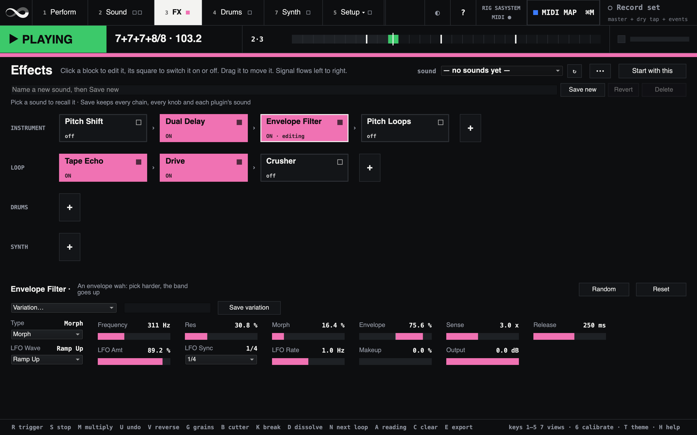

# Megalooper SA

Megalooper SA plays the instrument's effects, the bass's, the loop's effects,
the drums and the synth itself. This guide covers the effect chains, sounds and
plugins. The looper, the cutter, the grains and the MIDI map work as [the
manual](manual.md) says.

## Starting it

Megalooper SA plays on these rigs:

- **saSystem**, the one the launcher offers first, plays your instrument from
  the input device and input you choose there, the system's input 1 until you
  do, and the mix on the output's 1 and 2 ([Audio settings](routing.md)).
- A profile of your own in `profiles.scd` suits an aggregate device, a
  sample rate switched before the start, or several fixed setups ([Rigs of
  your own](routing.md#rigs-of-your-own)).

A bass can come in on an input of its own, **Bass** in the launcher ([A
bass](routing.md#a-bass)): it plays through its own chain, the **BASS** row on
the FX view.

Then open the **FX** view (key **3**) for the effects. The drums have a view
of their own, **Drums** (key **4**), and the synth, **Synth** (key **7**).

**Set the latency once.** saSystem assumes 30 ms for the way out and back in.
Run the round-trip step on the Calibrate view
([Calibrate](manual.md#calibrating-the-rig--the-wizard)), or overdubs will
land late or early.

## The chains

- **The instrument chain** (the **INSTRUMENT** row) is what you play through. The loop records its output.
- **The bass chain** is what the bass plays through, on a rig with a bass
  input. It goes to the mix only: the loop does not record it.
- **The loop chain** plays the recorded loop.
- **The drums chain** plays the drums' steps, before their reverb. It starts
  empty. The onset kit does not pass through it.
- **The synth chain** (the **SYNTH** row, last) plays the synth's notes,
  before the Synth strip. It starts empty.

Each chain is a row of tiles, played left to right.



*Fig: The FX view (3) on saSystem, with Dual Delay, Envelope Filter, Tape Echo and Drive switched on, and the Envelope Filter's panel open under the chains.*

| To | Do this |
|---|---|
| Edit an effect | Click its tile: its settings appear below |
| Switch it on or off | Click the square in its tile's corner (■ on, □ off), or press its footswitch. A click anywhere else on the tile never changes the sound |
| Add an effect or a plugin | Press **+** at the end of the chain. The EQ, Compressor and Noise Gate are under **Utility**; Freeze, Slicer, Tremolo, Octave Down and Ring Mod under **Texture**; the Reverb under **Space** |
| Move an effect | Drag its tile along the chain, or onto another chain. Esc lets go |
| Move or remove it by menu | Click its tile, then press **⋯** |
| Put a setting back to its default | Double-click it, or **Reset** for the whole effect |
| Keep an effect's settings | Type a name beside **Save variation**, under the effect's title, and press it. The variation holds every setting, and the menu beside it lists it for every effect of that type (both Delays, say). The same name again replaces it; **Delete:** in the menu removes it |
| Try out a random sound | **Random** beside Reset: every setting at a random value. **Undo random** takes the draw back (again for the one before); **Reset** brings the starting values back |
| Undo an edit | Cmd+Z. Shift+Cmd+Z redoes |

Edits are safe while a loop plays: the chain cross-fades to its new order.
An effect brought back by Undo keeps its settings.

[The effects](effects.md) says what each one does, with every setting.

### Variations

Each effect's menu lists the variations megalooper ships (Dual Delay, Envelope
Filter, Pitch Loops, Drive and Crusher have some), then yours, marked
**· yours**. Each shipped list starts with **starting values**: it puts the settings
the shipped variations move back where they start. A shipped variation
sets only some of the settings; one of yours sets them all. Yours are kept in `sa/fx-variations.json` in your megalooper
folder, apart from the sounds; a shipped variation's name cannot be taken for
one of yours.

## Sounds

A sound is all the chains as one file: which effects in which order, every switch
and setting, and each plugin's own state.

- **Save and recall.** The bar above the chains saves the sound under a name
  and recalls it from the menu. A recall never flips the switch of an effect
  already in a chain. With the same effects it changes only settings. With
  other effects it rebuilds the chains, also while a loop plays, and an
  effect it adds comes in on or off as saved.
- **Start with this** makes this sound the one megalooper starts with, every
  switch included. A dot on **Start with this** means something is not kept
  yet. A dot after an effect's name means one of its settings is off its
  starting value.
- **While a loop plays, a plugin's own sound is not written.** Writing it
  would silence the plugin for a moment. megalooper keeps the chains and says
  so; stop the loop and press again to keep the plugin's sound too.
- **Recover.** If you edited the chains and quit without keeping them, the
  next start offers them back. Nothing is loaded by itself.

Sounds are in `sa/sounds/` in your megalooper folder
(`~/Library/Application Support/SuperCollider/megalooper/`), and the kept one
is `sa/kept.json`. The last five kept sounds are in `sa/backups/kept/`. You
can copy a sound's `.json` file and its `.states` folder to another Mac.

### A variation or a sound?

Both keep settings under a name, but at two sizes. A variation is one
effect's settings. A sound is everything on the FX view.

| | A variation | A sound |
| --- | --- | --- |
| What it holds | The settings of one effect | Every chain: which effects, in which order, each switch, every setting, and each plugin's own state |
| Where it applies | Any effect of its type: a Dual Delay variation is in both Delays' menus | All the chains at once |
| On and off | Leaves the effect on or off as it was | Leaves the switches as they are; an effect the sound adds comes in as saved. **Start with this** keeps every switch for the next start |
| Plugins | Built-in effects only. A plugin keeps its own presets in its window | Holds each plugin's state |
| Saved and recalled | **Save variation** and the menu under the effect's title | The bar above the chains |
| Kept in | `sa/fx-variations.json` | `sa/sounds/`, one file per sound |

**Use a variation** for a setting of one effect you want to reach for again,
in any sound: a delay time that suits a song, a filter that sweeps the way
you like, a drive for loud parts. Pick one, then turn the knobs on from there.

**Use a sound** for the whole setup of a song or a part of the set: which
effects are in, in which order, the amp plugin and how it is dialled in.
Recalling a sound sets all of that at once, except the switches: those stay
as you left them.

**They work together.** A sound keeps the values of every setting, not the
name of the variation they came from. Recalling a variation changes the
effect as turning its knobs would. To keep that in a sound, save the sound
(or press **Start with this**). Changing or deleting the variation later
leaves the sounds you saved with it as they are.

**On stage** a footswitch switches effects on and off, and can press an
effect's Random or Reset (see [MIDI](#midi)). Variations and sounds are
recalled in the window.

## Plugins

megalooper hosts VST2 and VST3 effects through
[VSTPlugin](https://git.iem.at/pd/vstplugin). `./tools/install.sh` fetches
version 0.6.2 into SuperCollider's Extensions, unless a copy is there
already. Without VSTPlugin megalooper plays its built-in effects and lists no
plugins.

### Installing VSTPlugin by hand

On macOS:

1. Download VSTPlugin 0.6.2 from
   <https://git.iem.at/pd/vstplugin/-/releases>.
2. Put the `VSTPlugin` folder from the zip's `sc` folder into
   `~/Library/Application Support/SuperCollider/Extensions`.
3. Delete `VSTPlugin_supernova.scx` from that folder's `plugins` folder.
4. A copy downloaded in a browser is quarantined, and macOS refuses to run
   it. Clear the flag:
   ```bash
   xattr -dr com.apple.quarantine "$HOME/Library/Application Support/SuperCollider/Extensions/VSTPlugin"
   ```
5. Restart megalooper.

On Linux, put the `VSTPlugin` folder from the Linux zip's `sc` folder into
`~/.local/share/SuperCollider/Extensions`. Steps 3 and 4 are macOS's alone.

megalooper checks all of this at every start and names what is wrong, in the
post window or in `~/Library/Logs/megalooper.log`.

### Finding and adding plugins

1. Stop the loop, press **+** on a chain and choose **Scan for plugins…**.
   The scan runs beside megalooper and can take a minute. What it did is in
   `sa/plugins/scan.log` in your megalooper folder.
2. Press **+** again. Your plugins are listed by maker, under the built-in
   effects.
3. Choose one. Its tile appears at the end of the chain, and the status line
   under the chains says when it is open.
4. To see the plugin's own window, click its tile and press **⋯**, then
   **Open its window**.

What to expect:

- **Effects only here.** Instruments are not on the + menu: the Synth view's
  **Instrument** menu plays them ([The synth](synth.md#a-vst-instrument)).
  Audio Units are not hosted.
- **Intel-only plugins are greyed.** megalooper does not use VSTPlugin's
  bridge yet.
- **A plugin that adds delay is held back.** With more than 64 samples of
  reported delay, the chain plays without it and its tile says why.
- **A plugin that is not on this Mac keeps its place.** A sound that names
  one shows it as missing and keeps its state, so nothing is lost when you
  save the sound again.
- **A plugin that crashed megalooper is skipped once.** The next start leaves
  it closed and says so; the start after that tries it again.

### An amp for the guitar

megalooper has no amp simulator of its own, and a DI guitar through the
built-in effects alone sounds thin. Add an amp plugin to the instrument chain.
These are free and come as VST3. None of them was tested with megalooper:

- [Neural Amp Modeler](https://www.neuralampmodeler.com/)
- [AmpliTube 5 CS](https://www.ikmultimedia.com/products/amplitubecs/)
- [Guitar Rig Player](https://www.native-instruments.com/en/products/komplete/guitar/guitar-rig-7-player/)
- [Blue Cat's Free Amp](https://www.bluecataudio.com/Products/Product_FreeAmp/)

## MIDI

In MIDI MAP mode every built-in effect's switch, its settings, **Random** and
**Reset** can be mapped; a second Dual Delay gets entries of its own. A
plugin's switch and knobs cannot: a footswitch reaches inside a plugin
through its eight sends (below). [The manual](manual.md#midi) has the
details.

### A footswitch for something inside a plugin

A plugin's own switches, such as an amp simulator's scenes, are learnt
inside the plugin from a MIDI controller. A hosted plugin hears none of your
controllers, because megalooper does. So megalooper sends:

1. Click the plugin's tile. Its page has a row **MIDI to the plugin**, with
   the numbers 1 to 8.
2. In the plugin's own window, start its MIDI learn for the thing to switch.
3. Click a number in megalooper. The plugin learns the controller it sends
   (CC 20 to 27).
4. Press **MIDI MAP**, click that number, and press your footswitch.

## On a slower computer

- **Switch off what you don't play.** Once it has faded out, a switched-off
  Envelope Filter, Drive or Crusher stops computing, and so does any plugin:
  it costs nothing until you switch it on again. Dual Delay, Tape Echo, Pitch
  Loops and Pitch Shift keep running while off, so that switched on they
  already hold the last seconds of your playing.
- **The drums rest when they are quiet.** Their reverb and the onset kit's
  chain stop a second after the last drum has rung out, and the next hit
  wakes them. While a device on the drums' chain is on, the reverb stays
  awake for it.
- **No room, no new effect.** Past 85 % CPU at its peak, or with the
  effects' memory full, megalooper refuses to add an effect and says why.
- **A bigger buffer.** If you hear clicks or gaps, pick 256 frames under
  **Buffer** in the launcher. At 48 kHz that adds about 5 ms each way, so run
  the round-trip step on the Calibrate view again afterwards.
- The **CPU** figure in the top bar is the audio server's load. It turns red
  past 60 %.

## When something is wrong

- **The status line** under the chains names a plugin that failed, is
  missing or is held back, and drum hits that had to be dropped.
- **Copy diagnostics**, at the end of the **⋯** menu, puts megalooper's
  state on the clipboard: versions, the chains, each plugin's state. Paste it
  into a bug report.
- **Cmd+Period** stops the server and everything on it. Start megalooper
  again afterwards.
