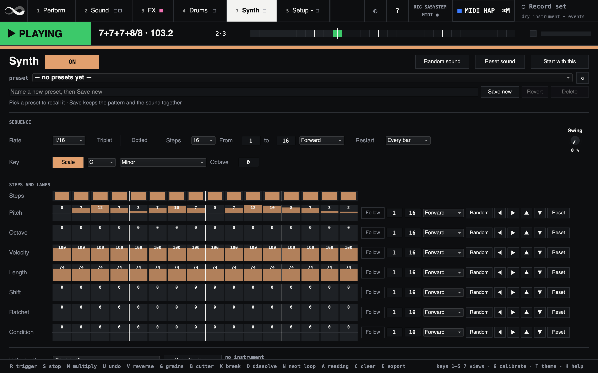
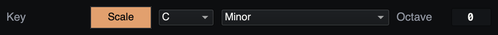
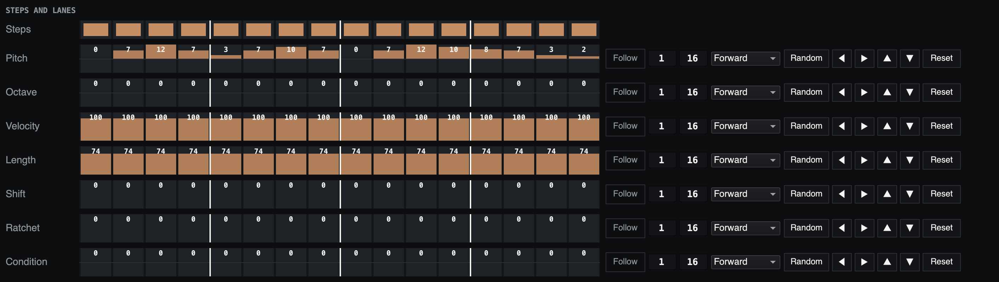
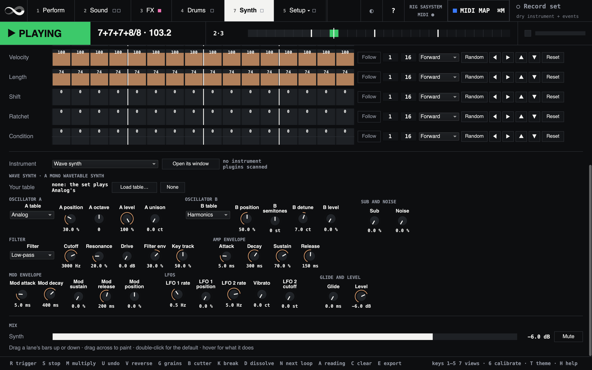

# The synth

Megalooper SA has a synth beside the drums: a **note sequencer** that plays
one note a step, and the **Wave synth** it plays, a monophonic wavetable
synth. One of your VST instruments can play the notes instead. It all lives
on the **Synth** view (key **7**), with a column of its own on Perform.

The sequencer keeps time with the loop. It plays on the drums' grid, so it
starts with a new loop, follows the next reading, and starts again on the
loop's bar lines, uneven ones too.

## Switching it on

The synth is off at every start. Switch it on with the **ON** switch at the
top of the Synth view, the Synth column's switch on Perform, or a footswitch
mapped to it (see [MIDI](#midi)). It sounds from the moment you switch it,
from wherever the drums' grid is.

It plays whether the drums themselves are on or not. The drums' switch
doesn't touch it: only its own switch does. Stop
silences it with everything else, and so does the loop's break, for as long as
the loop is silent. Its random parts are the drums' dice: kept on the Drums
view, every Start plays the same line (see [the drums](drums.md#the-steps)).

A fresh install starts with a line in C minor round the root, on all sixteen
steps. Make it yours, then press **Start with this** (see
[Presets](#presets-and-start-with-this)).

## The sequence

*Fig: The Synth view (7) with megalooper's own pattern: a line in C minor on all sixteen steps, every lane following the sequence.*

The **Sequence** row says how the steps run:

- **Rate**: how long a step is, from 1/1 to 1/64; 1/16 unless you change
  it. **Triplet** makes it two thirds as long, **Dotted** half as long
  again.
- **Steps**: 8 or 16.
- **From** and **to**: the first and last step the sequence plays.
- **Direction**: *Forward*, *Backward*, *Alternate* (there and back),
  *Snake* (a step up or down at random) or *Random*.
- **Restart**: where it starts again from its first step. *Every bar*, the
  default, restarts on every bar line of the loop, uneven bars included, so
  a 16-step line in 7/8 plays its first fourteen steps in every bar. *Every
  loop* restarts once a pass, and *Never* runs on from the drums' start.
- **Swing**: every second step late, up to half a step. 0 plays them
  straight.

## The key and the scales

*Fig: The Key row on the Synth view: Scale on, C minor, octave 0.*

The **Key** row sets the notes the pitches play: the **Scale** switch, the
**root**, the **scale** and the line's **Octave**.

### How a pitch becomes a note

Each step's note is worked out the same way:

1. **The root plus the pitch.** The Pitch lane counts semitones from the
   root, −12 to 12, and the root sits in the octave from middle C: pitch 0
   with root C is middle C, with root A it is the A above it. So the root
   transposes the whole line.
2. **Snapped to the scale**, when **Scale** is on: a pitch that is not in
   the scale plays the scale's note just **below** it. With Scale off,
   every semitone plays as it is.
3. **Plus the octaves**: the step's Octave lane and the line's **Octave**,
   −3 to 3 each, added after the snap, so they never take a note out of
   the scale.

Notes past the ends of MIDI's range (0 to 127) stay at the end.

Because the pitch counts semitones and not steps of the scale, two pitches
next to each other can play the same note. In C minor:

| Pitch | −3 | −2 | −1 | 0 | 1 | 2 | 3 | 4 | 5 | 6 | 7 | 8 | 9 | 10 | 11 | 12 |
|---|---|---|---|---|---|---|---|---|---|---|---|---|---|---|---|---|
| Plays | G# | A# | A# | C | C | D | D# | D# | F | F | G | G# | G# | A# | A# | C |

To write a line by the scale's steps, use the numbers in its row of the
table below: in Minor, 0 2 3 5 7 8 10 12 are its eight notes up to the
octave. Anything in between repeats the note below, which is handy for a
Random that stays in key: drawn pitches can only land on the scale.

### Changing the key while it plays

The root, the scale and the switch can all be changed while the line plays;
the next notes follow. The root and the scale are MIDI targets too: map a
knob to one in MIDI MAP mode, and its travel is shared out over the twelve
roots, or the 35 scales, in the order of their menus.

- **Another root** moves the whole line, every interval kept: from C to F
  is a change to the IV.
- **Another scale** snaps the same pitches again. They do not move to the
  same step of the new scale: they fall to the nearest note at or below.
  A line written in Minor and switched to Major plays its minor third
  (pitch 3) as D, the second, and its minor seventh (10) as A, the sixth.
- **0 and 12 are in every scale**, so the root and its octave never move
  when the scale does. The fifth (7) is in all but eight: Locrian, Whole
  tone, Whole-half diminished, Lydian augmented, Super Locrian, Spanish
  eight-tone, Iwato and Messiaen mode 6. A line built on 0, 7 and 12 keeps
  its shape across most of them.

### The key the loop was heard in

The status band shows a key for the take (`Dm`, say), from the notes the
pitch tracker heard. The synth does not follow it by itself: set the root
and the scale to match, or ask an AI app for a line over the chords it
heard (see [AI apps](ai.md)).

### All 35 scales

| Scale | Semitones above the root | Notes, root C |
|---|---|---|
| Major | 0 2 4 5 7 9 11 | C D E F G A B |
| Minor | 0 2 3 5 7 8 10 | C D D# F G G# A# |
| Dorian | 0 2 3 5 7 9 10 | C D D# F G A A# |
| Mixolydian | 0 2 4 5 7 9 10 | C D E F G A A# |
| Lydian | 0 2 4 6 7 9 11 | C D E F# G A B |
| Phrygian | 0 1 3 5 7 8 10 | C C# D# F G G# A# |
| Locrian | 0 1 3 5 6 8 10 | C C# D# F F# G# A# |
| Whole tone | 0 2 4 6 8 10 | C D E F# G# A# |
| Half-whole diminished | 0 1 3 4 6 7 9 10 | C C# D# E F# G A A# |
| Whole-half diminished | 0 2 3 5 6 8 9 11 | C D D# F F# G# A B |
| Minor blues | 0 3 5 6 7 10 | C D# F F# G A# |
| Minor pentatonic | 0 3 5 7 10 | C D# F G A# |
| Major pentatonic | 0 2 4 7 9 | C D E G A |
| Harmonic minor | 0 2 3 5 7 8 11 | C D D# F G G# B |
| Harmonic major | 0 2 4 5 7 8 11 | C D E F G G# B |
| Dorian #4 | 0 2 3 6 7 9 10 | C D D# F# G A A# |
| Phrygian dominant | 0 1 4 5 7 8 10 | C C# E F G G# A# |
| Melodic minor | 0 2 3 5 7 9 11 | C D D# F G A B |
| Lydian augmented | 0 2 4 6 8 9 11 | C D E F# G# A B |
| Lydian dominant | 0 2 4 6 7 9 10 | C D E F# G A A# |
| Super Locrian | 0 1 3 4 6 8 10 | C C# D# E F# G# A# |
| Spanish eight-tone | 0 1 3 4 5 6 8 10 | C C# D# E F F# G# A# |
| Bhairav | 0 1 4 5 7 8 11 | C C# E F G G# B |
| Hungarian minor | 0 2 3 6 7 8 11 | C D D# F# G G# B |
| Hirajoshi | 0 2 3 7 8 | C D D# G G# |
| In-sen | 0 1 5 7 10 | C C# F G A# |
| Iwato | 0 1 5 6 10 | C C# F F# A# |
| Kumoi | 0 2 3 7 9 | C D D# G A |
| Pelog selisir | 0 1 3 7 8 | C C# D# G G# |
| Pelog tembung | 0 1 5 7 8 | C C# F G G# |
| Messiaen mode 3 | 0 2 3 4 6 7 8 10 11 | C D D# E F# G G# A# B |
| Messiaen mode 4 | 0 1 2 5 6 7 8 11 | C C# D F F# G G# B |
| Messiaen mode 5 | 0 1 5 6 7 11 | C C# F F# G B |
| Messiaen mode 6 | 0 2 4 5 6 8 10 11 | C D E F F# G# A# B |
| Messiaen mode 7 | 0 1 2 3 5 6 7 8 9 11 | C C# D D# F F# G G# A B |

The note names follow the root menu, which spells every black key as a
sharp: in C minor, D# is E♭.

## Steps and lanes

The **Steps** strip is the sixteen steps, each on (lit) or off. Click one to
switch it, or drag across to switch a run the same way. A frame shows where
the sequence is.

*Fig: Steps and lanes on the Synth view: the sixteen steps, then a lane for each setting, with its own length, direction and tools.*

Under it are seven **lanes**, a value per step each:

| Lane | Range | Default | What it does |
|---|---|---|---|
| **Pitch** | −12 to 12 | 0 | Semitones above the root |
| **Octave** | −3 to 3 | 0 | Octaves up or down, on top of the pitch |
| **Velocity** | 0 to 127 | 100 | How hard the step plays; 0 plays nothing |
| **Length** | 0 to 100 | 74 | How long the note is held, in % of a step |
| **Shift** | 0 to 100 | 0 | How late the note is, in % of a step |
| **Ratchet** | 0 to 6 | 0 | The step played this many more times, evenly through it |
| **Condition** | −10 to 10 | 0 | On which passes the step plays (below) |

Click or drag in a lane to set a step, drag across to paint, and
double-click for the default. Each value is written in its cell. Hover over
anything for what it does.

A **Length** of 100 runs into the next note: legato, with no new attack, and
with **Glide** a slide to the new pitch.

The **Condition** counts the times its lane has gone round, a restart
counting as going round:

- 0 or 1 always plays;
- 2 plays every second pass (the first included), 3 every third, and so on;
- −1 never plays;
- −2 plays all but every second pass, −3 all but every third, and so on.

With **Restart** on *Every bar* the passes are bars: a step with 4 plays in
the first bar and every fourth one after it, and a step with −4 rests there
and plays in all the others.

### Lanes of their own

A lane **follows** the sequence's steps unless you switch it to **Own**. It
then has its own first step, last step and direction. Lanes of different
lengths drift against each other: five pitches over a sixteen-step rhythm
come round in a different place every bar, and a seven-step velocity lane
puts the accents somewhere new each time.

Each lane has its tools: **Random** draws every step of its span at random:
pitches −12 to 12, octaves −1 to 1, velocities 67 to 127, lengths 40 to 100,
shifts 0 to 30, ratchets 0 to 2 and conditions −4 to 4. **◀** and **▶**
move its steps one earlier or later (the end coming round), **▲** and **▼**
move every value one up or down, and **Reset** puts the lane back to its
default.

## The Wave synth

*Fig: Further down the Synth view: the instrument, your table, the Wave synth's settings in their groups, and the Synth strip.*

A mono wavetable synth: a new note ends the one before. Its settings are
under the lanes, a knob each, in groups:

| Group | Settings |
|---|---|
| **Oscillator A** | Its table set, its position in the set, octave, level, and unison (two more copies of A, this many cents above and below) |
| **Oscillator B** | Its table set, position, semitones, detune and level (0 at first: A alone) |
| **Sub and noise** | A sine an octave under A, and noise |
| **Filter** | Low-pass, band-pass or high-pass; cutoff, resonance, drive (into a soft clip before the filter), how far the mod envelope moves the cutoff, and how far the cutoff follows the note |
| **Amp envelope** | Attack, decay, sustain, release |
| **Mod envelope** | Its attack, decay, sustain and release, and how far it moves both oscillators through their tables |
| **LFOs** | LFO 1 sweeps both oscillators' positions; LFO 2 is vibrato and moves the cutoff |
| **Glide and level** | Every note slides from the one before over this long; the synth's level |

An oscillator plays a **set** of eight tables and crossfades between them as
its **position** moves:

- **Analog**: sine, triangle, saw, square, then narrower and narrower pulses.
- **Harmonics**: a saw's partials, more and more of them.
- **Vowels**: u, o, a, ae, e, i, y and er.
- **Organ**: drawbar registrations.
- **Your table**: a wavetable of yours (below).

Every table is band-limited, so high notes do not alias.

**Random sound**, at the top of the view, draws every setting at random but
the level and the glide: a new sound for the same line. **Reset sound**
puts every setting back as megalooper ships it. Neither touches the pattern.
Save a preset first to keep the sound you have.

### Your own wavetable

**Load table…**, on the **Your table** row, reads a wavetable WAV as Serum
and Vital write them: cycles of 2048 samples one after another, up to 256 of
them. Eight cycles spread through the file become the set's eight
positions. Choose **Your table** as oscillator A's or B's set to play it.

The file is copied into your megalooper folder and kept with the sound in
presets and in Start with this. **None** goes back to no table of yours:
the set then plays Analog's.

## A VST instrument

The **Instrument** menu picks what plays the notes: the **Wave synth**, or
one of your instrument plugins. Scan your plugins on the FX view first (see
[Plugins](standalone.md#plugins)); the instruments among them are listed
here. VST2 and VST3 only, as for the effects.

A plugin plays its own sound: **Open its window** and set it there. The
sequencer sends it a note-on and a note-off for every note, with its
velocity. Presets and Start with this keep which instrument it is and its
state, the sound you set in its window.

While a plugin plays, the Wave synth's settings stay as they were, and its
controls in Perform's Synth column are greyed.

## The mix

The synth has a chain of its own, **SYNTH**, the last row on the FX view:
effects after the instrument, as on the other chains. Then the **Synth**
strip, at the bottom of the Synth view, sets its level and mutes it.

When you record the set, the synth is written to a stem of its own beside
the drums'.

## Presets and Start with this

The preset bar keeps the **pattern and the sound together**: every step,
lane and setting of the sequence, the Wave synth's settings, your table,
and the instrument with its state. Choosing a preset recalls it at once.
The switch and the Synth strip's level are not in it.

**Start with this** keeps the pattern and the sound as they are now: the
next start begins with them instead of megalooper's own. The synth still
starts switched off.

## On Perform

Perform has a **Synth** column: the switch, two of the Wave synth's settings
to play with while the line runs, **Cutoff** and **Position** (oscillator
A's place in its set, the sound's colour), and **Random** for a new sound.
Each note takes the cutoff and the position it starts with.

## MIDI

No shipped map puts the synth on a footswitch. In MIDI MAP mode, click any
of these and move a knob or press a switch (see
[the manual](manual.md#mapping-your-own-controller)):

- the switch, **Random sound** and **Reset sound**;
- the sequence's **Rate**, **Swing**, **root** and **scale**;
- every setting of the Wave synth;
- the **Synth** strip's level and mute;
- **Show Synth**, the view itself, in the MIDI map's list on Setup.

## AI apps

An AI app can read the note sequence and the Wave synth, change them, switch
the sequencer and save a preset: "a line in D dorian that follows the chords
you heard". See [AI apps](ai.md).

## Where things are

In `~/Library/Application Support/SuperCollider/megalooper/`:

| Folder | What it holds |
|---|---|
| `sa/synth-presets/` | The synth's presets, one JSON file each |
| `sa/kept-synth/` | What Start with this kept |
| `sa/wavetables/` | The wavetables you loaded |
